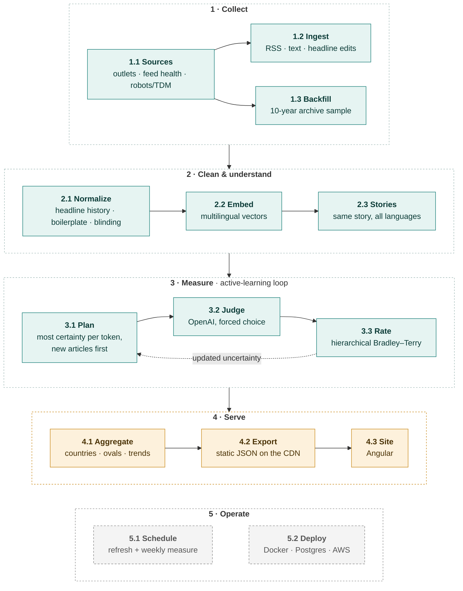

# BasedNews — where does your country's news lean, and how sure are we?

[](https://github.com/axelsolhall/BasedNews/actions/workflows/ci.yml)

BasedNews places **news outlets and whole countries on a two-axis political map** (economic left–right ×
social liberal–conservative), **relative to each other**, with an **uncertainty oval** around every position.
An LLM compares **pairs of articles about the same story**, across 73 outlets in 10 countries and 7 languages. A
hierarchical Bayesian model turns those verdicts into positions, and also chooses which comparison is worth paying
for next.

> **Status (2026-10-11): the measuring method is complete for one snapshot in time and runs on real data. Not
> finished: positions over time (a must), validation, serving and operations. No positions are claimed yet.** Real-data experiments are exploratory
> ([docs/experiments](docs/experiments)); the ones that test something are pre-registered. The site shows a labelled demo.

## Where it stands

| Stage | State |
|---|---|
| **1 · Collect** | 🟩 Done, signed off 2026-10-11. Live RSS ingest plus a sparse 10-year archive sample; the sample is about half fetched (2021–2025 pending) and resumes where it stopped. |
| **2 · Clean & understand** | 🟩 Done, signed off 2026-10-11. Embeddings run locally (MiniLM). The OpenAI backend is built and waits for its calibration run (A45, A47). |
| **3 · Measure** | 🟩 Method complete for one snapshot: article-aware planner, judge prompt v4, hierarchical rating. 2,126 judge calls on real story pairs so far. Validation against an external rating is pre-registered and in progress (E4–E6). ⬜ **Positions over time not built yet (a must, see What's left).** |
| **4 · Serve** | 🟧 Prototype. The site replays a simulated demo and the first real run (E4, whose prompt and model are now replaced). The Spring Boot API is dropped; the site will read static JSON (ADR-010). |
| **5 · Operate** | ⬜ Not built. Runs are started by hand. Scheduling and deployment (Docker, Postgres, AWS) are open. |

What remains is listed under [What's left](#whats-left).

## The pipeline at a glance



🟩 runs on real data · 🟧 prototype · ⬜ not built yet

Every step has one job, a typed contract, persisted output and **its own check** that runs in isolation. That way a
problem can be traced to the step that causes it. Each stage below has a short summary; open **Details** for the
steps. Step numbers match the diagram. `M1`…`M9` are the module IDs used in the code, ASSUMPTIONS.md and BACKLOG.md
(module index: [pipeline/README.md](pipeline/README.md)).

---

## 1 · Collect
Pick the outlets and check we may read them (1.1). Pull every new article on each run (1.2). Add a sparse 10-year
history from archive.org (1.3).
**Status:** 🟩 done, signed off 2026-10-11. The history sample is about half fetched (2021–2025 pending); the backfill
resumes where it stopped.
**Sign-off:** `uv run python -m pipeline.signoff --stage collect`

<details>
<summary><b>Details: 1.1 Sources · 1.2 Ingest · 1.3 Backfill</b></summary>

### 1.1 Sources · `M1` · `pipeline/sources/`
- **Does:** keeps the outlet registry and checks each outlet: feeds alive, freshness, robots.txt and the W3C TDM
  opt-out.
- **In → out:** `data/outlets.json` (73 outlets, 10 countries) → `feed_health`.
- **Reference set:** in each country, the five largest online news brands in the Reuters Institute *Digital News
  Report 2026* define that country's position (A29). Other outlets are extras.
- **Policy:** publishers that opt out or block bots are read as headline + summary only (A10, A33). We never spoof a
  browser or solve a challenge.
- **Check:** `uv run python -m pipeline.sources.run && uv run python -m pipeline.sources.eval`

### 1.2 Ingest · `M2` · `pipeline/ingest/`
- **Does:**
  - reads RSS and skips known URLs before downloading;
  - extracts text (JSON-LD → trafilatura → summary, A19);
  - strips HTML, site notices and paywall pages (A38);
  - records a new headline when a known URL's headline changes (A34);
  - dates undated items by when they were first seen (A39).
- **In → out:** feeds → `articles`, `headlines`.
- **Check:** `uv run python -m pipeline.ingest.report` → the chart and tables below. `--samples 1` prints text
  snippets; `--readme` refreshes the table.


Left: the sparse archive.org sample, taken on the same dates for every outlet (hatched = not fetched yet), then the
live RSS ingest. Right: what the judge can read; orange is policy, not a bug. Per-outlet detail:
[`reports/m2_ingest.md`](reports/m2_ingest.md).

<!-- m2:begin -->
*Snapshot 2026-10-11, regenerated by `uv run python -m pipeline.ingest.report --readme`.*

| Country | Outlets (ref / all) | Articles | Last 72 h | Last 14 d | History years (of 10, mean) | Full text | Summary only | Dated | Pass |
|---|---:|---:|---:|---:|---:|---:|---:|---:|---:|
| Norway | 5 / 6 | 512 | 366 | 413 | 4.0 | 94 % | 6 % | 100 % | 6/6 |
| Sweden | 5 / 6 | 742 | 570 | 644 | 4.8 | 74 % | 26 % | 100 % | 6/6 |
| Denmark | 5 / 7 | 400 | 279 | 295 | 4.3 | 94 % | 6 % | 100 % | 7/7 |
| Finland | 5 / 5 | 587 | 508 | 508 | 4.0 | 93 % | 7 % | 100 % | 5/5 |
| United States | 5 / 10 | 724 | 510 | 537 | 5.3 | 78 % | 22 % | 100 % | 10/10 |
| United Kingdom | 5 / 6 | 872 | 639 | 701 | 4.5 | 47 % | 53 % | 100 % | 6/6 |
| Germany | 5 / 9 | 1,808 | 1,409 | 1,612 | 5.2 | 74 % | 26 % | 100 % | 9/9 |
| France | 5 / 9 | 715 | 590 | 598 | 3.3 | 24 % | 76 % | 100 % | 8/9 |
| Spain | 5 / 7 | 1,372 | 1,176 | 1,244 | 4.9 | 89 % | 11 % | 100 % | 7/7 |
| Italy | 5 / 8 | 743 | 611 | 627 | 4.0 | 92 % | 8 % | 100 % | 8/8 |
| **All** | 50 / 73 | **8,475** | 6,658 | 7,179 | 4.5 | 75 % | 25 % | 100 % | 72/73 |
<!-- m2:end -->

### 1.3 Backfill · `M2b` · `pipeline/backfill/`
- **Does:** fetches archived homepages and feeds on a fixed date grid (yearly → quarterly → monthly, on the 15th).
  It takes about 4 articles per outlet per date, on the same dates for every outlet, so countries stay comparable
  (A23, A24). History comes only from this sample; rows from the pre-pipeline scraper are retired (A37).
- **In → out:** archive.org snapshots → `articles` (`text_source = wayback-*`). Progress is kept in `backfill_jobs`
  (resumable).
- **Check:** `uv run python -m pipeline.backfill.eval`

</details>

---

## 2 · Clean & understand
Turn raw articles into stories:
- merge renamed copies, split live-blog pages and remove boilerplate (2.1);
- embed every article in one multilingual space (2.2);
- group articles about the same story across outlets and languages (2.3).

**Status:** 🟩 done, signed off 2026-10-11. To be re-checked when the embeddings move to OpenAI (A45, A47).

<details>
<summary><b>Details: 2.1 Normalize · 2.2 Embed · 2.3 Stories</b></summary>

### 2.1 Normalize · `M3` · `pipeline/normalize/`
- **Does:**
  - **Renames and containers:** when one stored text appears under several headlines, decides by content whether it
    is one article that was renamed (any number of times → one article with a headline history) or a live-blog or
    news-list page. On a page, only the entry that matches it keeps the text (A34).
  - **Boilerplate:** removes paragraphs that repeat across an outlet's articles at the start or end, across different
    stories: footers, pop-ups, tip boxes, copyright lines. Repeats in the body text are kept (A40).
  - **Non-articles:** marks items that are not one article (multi-topic show pages, site pages, headline-only items)
    and drops consent walls (A38).
  - **Blinding and genre:** removes the outlet's own name from titles (A42) and tags opinion pieces (A43).
  - **Article content is never shortened or rewritten**; only non-content is removed (A41).
- **In → out:** `articles` → `articles.canonical_id`, `kind`, `genre`, `headlines`. Removed texts are backed up, so
  every step can be reversed.
- **Check:** `uv run --group ml python -m pipeline.normalize.run`, then
  `uv run python -m pipeline.normalize.eval --samples 3` → `reports/m3_normalize.png`.

### 2.2 Embed · `M4` · `pipeline/embed/`
- **Does:** one multilingual vector per article (A12). An article with several headlines gets the mean over its
  versions (A35).
- **Backends:** local multilingual MiniLM (active) or OpenAI `text-embedding-3-small` (built). Similarity thresholds
  belong to the model: each model has a calibrated profile, and a model without one refuses to run 2.1 and 2.3
  (A47, `pipeline.embed.calibrate`).
- **In → out:** canonical `articles` + `headlines` → `embeddings` (re-embedded when a new headline arrives).
- **Check:** `uv run --group ml python -m pipeline.embed.eval`: are an article's nearest neighbours the same story in
  other languages?

### 2.3 Stories · `M5` · `pipeline/events/`
- **Does:** time-aware average-linkage clustering (72 h window, 96 h decay, threshold from the model's profile; A20,
  ADR-004). A story with articles from two outlets gives a comparable pair (A02). Two outlets publishing the same
  headline and the same text is a known tie: it is kept but never sent to the judge (A44).
- **In → out:** `embeddings` → `event_members`, `same_text_pairs`.
- **Check:** `uv run --group ml python -m pipeline.events.eval` (precision and recall per threshold on the labelled
  pairs in `data/eval/`, kept local). Results so far are in VERIFY.md.

</details>

---

## 3 · Measure
The active-learning loop:
- choose the comparisons that cut uncertainty most per token, preferring articles not judged yet (3.1);
- ask an LLM which of two articles about the same story leans further on each axis (3.2);
- update every outlet's position and uncertainty (3.3).

**Status:** 🟩 method complete; runs on real story pairs with a budget cap. Validation is in progress, see
[Experiments](#experiments-on-real-data).

<details>
<summary><b>Details: 3.1 Plan · 3.2 Judge · 3.3 Rate · the loop</b></summary>

### 3.1 Plan · `M6` · `pipeline/plan/`
- **Does:** scores every available story pair by the expected reduction in outlet and country variance **per
  token**, on both axes jointly (A31, A32, ADR-002). It works per article: a new article enters with the full
  article spread, while one already judged is mostly pinned down, so repeated looks at the same article have
  diminishing returns (A49, ADR-009).
- **Pairs:** like with like only (full text with full text, news with news, opinion with opinion; A21, A43). Known
  ties and pairs already judged with the current prompt are skipped. Article order is random (A04).
- **In → out:** stories + current posterior + budget → comparison requests.
- **Check:** `uv run python -m pytest -q tests/test_hierarchical.py` (diminishing returns). Simulator:
  `uv run python -m pipeline.sim.eval_loop`.

### 3.2 Judge · `M7` · `pipeline/judge/`
- **Does:** one call per article pair answers both axes as a forced choice, with no reasons (prompt v4, A46).
  - **Questions:** "Which article's framing is more economically LEFT: A or B?" and "Which article's framing is more
    LIBERAL: A or B?". On a random half of calls the questions are worded RIGHT and CONSERVATIVE instead.
  - **"na"** only when the story has no angle on that axis (A32).
  - **Axis definitions** are in the system prompt: what each side centres, and what it treats as the problem and as
    the solution. The prompt also says what is *not* a leaning: quoting officials, length, tone, language, order.
    Full text in [`pipeline/judge/prompt.py`](pipeline/judge/prompt.py).
- **Input:** the whole article, never shortened (A41); the latest headline plus earlier versions (A36); the outlet's
  own name masked (A42).
- **Model and logging:** `gpt-5.4-mini` with low reasoning effort (A11, A45). Every call, verdict, token and cent is
  stored with the prompt version (`judge_calls`, `judgments`, `api_usage`; A48).
- **Full archive of every paid call (A51):** the exact request with the rendered articles, the provider's full
  response (model snapshot, fingerprint, token breakdown), timing, retries and failures, and what the planner knew
  when it picked the pair. Later analyses never have to buy a call again. Check: `uv run python -m pipeline.judge.calllog`.
- **Check:** `uv run python -m pipeline.judge.eval --pairs 60` → `reports/m7_judge_eval_v4.md`. It measures:
  - order swap, test–retest and the mirrored question (A28);
  - first-shown and length lean;
  - identical pairs;
  - cost per call.

  Run it after any prompt or model change; `--prompt v3` compares with an older version.

### 3.3 Rate · `M8` · `pipeline/rate/`
- **Does:** hierarchical Bayesian Bradley–Terry. Each article sits around its outlet (θ_article = θ_outlet + ε). The
  model includes a judge order-bias term β and a per-comparison sharpness (full text vs summary).
  - **Spreads:** the outlet spread τ and article spread σ_a are estimated from the data (Laplace evidence) and
    averaged over a grid, not set by hand (A49, ADR-009).
  - **Output:** a Laplace posterior gives every outlet a position and an sd per axis (A05, ADR-001, ADR-003).
- **In → out:** `judgments` → `positions` (mean, sd, number of comparisons per outlet and axis) + covariance.
- **Check:** `uv run python -m pytest -q` (recovery tests). Coverage under article reuse:
  `uv run python -m pipeline.sim.eval_articles` (E5).

### The loop · `pipeline/measure/`
- `pipeline.measure.run`:
  1. plans a batch;
  2. judges it in parallel;
  3. refits;
  4. repeats.

  It stops at `--budget-usd`, `--max-calls` or the monthly cap (`BASEDNEWS_MONTHLY_AI_USD`, default $12; A48). The
  final fit is written to `positions`. `--dry-run` prints the first prompt and the cost estimate;
  `--countries "United States,United Kingdom"` restricts the pool.

</details>

---

## 4 · Serve
Turn outlet positions into what a reader sees: country positions and ovals (4.1), published as static JSON files
(4.2) and drawn by the site (4.3). There is no API server (ADR-010).
**Status:** 🟧 prototype. The current fit is not yet exported to the site.

<details>
<summary><b>Details: 4.1 Aggregate · 4.2 Export · 4.3 Site · what a reader will get</b></summary>

### 4.1 Aggregate · `M9` · `pipeline/aggregate/`
- **Does:** everything is relative. (0, 0) is the average reference outlet (A26, ADR-005). A country is the
  reach-weighted mean of its reference outlets (A08). Ovals are ±1 sd per axis (A25). Country sds use the full
  posterior covariance.
- **In → out:** a posterior → plane points (outlets, countries, ovals).
- **Check:** `uv run python -m pipeline.aggregate.preview` (oval coverage close to 1 − e^(−k²/2)).
- **Gap:** only the E4 replay (`pipeline.experiments.e4_frames`) writes real points for the site. A general export
  of the current `positions` fit does not exist yet.

### 4.2 Export (not built yet)
- **Will do:** write the current fit and the trends as small JSON files next to the site, under about 100 kB per view
  compressed. Only aggregates; article text never leaves the private side (A10).

### 4.3 Site · `frontend/` (Angular)
- **Does:** world plane → click a country → its outlets; play the measurement over time. Run with
  `bash scripts/start.sh` (site :4200).
- **Today the plane shows:**
  - a simulated demo (real outlets and story pairs, random positions; active vs random selection);
  - a replay of E4, the first real run, which used prompt v3 and the flat model, both since replaced.

  Both are labelled on the page.
- **Data:** the plane reads static JSON from `frontend/src/assets` today; the export step (4.2) will write it.
- **Never serves article text** (A10).

### What a reader will get
- **World view:** each country's national media as a dot with an uncertainty oval. Click a country →
- **Country view:** its major outlets, each with its oval.
- **Story lens & blindspots:** how the same international story is framed across countries and outlets.
- **Historical change graphs (must, not built yet):** each outlet's and country's position over the last 10 years,
  with its uncertainty band, backed by the archive sample.
- **Methodology in the open:** prompts, maths, assumptions, evaluation results.

</details>

---

## Experiments on real data
E4 and E6 were pre-registered (criteria fixed and hashed before the run). Every experiment is recorded whatever the
outcome. They are **exploratory, not claims**. What they changed:

| ID | Question | What it changed | Record |
|---|---|---|---|
| E1–E3 | Does cost-aware selection save tokens? (simulation; E3 replays real stories with simulated verdicts) | planner design | [METHOD.md](docs/METHOD.md) |
| E4 | First real measurement, $2, 10 countries: does the judge reproduce known orderings (AllSides ratings, within-country contrasts)? | social-axis definition rewritten → prompt v4 | [e4_results](docs/experiments/e4_results.md) |
| E4b | The same US/UK pairs re-judged with prompt v4 | v4 adopted | [e4b_results](docs/experiments/e4b_results.md) |
| E4c | Why did single outlets disagree? Respecting noise, no prompt tuning toward expected answers | found article reuse → F1, hierarchical model | [e4c_diagnosis](docs/experiments/e4c_diagnosis.md) |
| E5 | Simulation: does reusing articles break the flat model's intervals? | hierarchical model adopted (ADR-009) | [e5_article_effects](reports/e5_article_effects.md) |
| E6 | Fresh stories with v4, the hierarchical model and the article-aware planner | to be repeated out of sample on next week's stories | [e6_results](docs/experiments/e6_results.md) |

A50 states what is measured: framing of the **same event**, not which stories an outlet chooses to cover. External
ratings include both, so agreement with them has a ceiling below 1. Disagreement is something to explain, not a
target to tune toward.

## Key findings about the method
**F1 — measure outlets over their articles.** One article compared many times is not independent evidence. On real
verdicts, 81–87 % of the variation in judged framing is article-to-article within an outlet (ICC 0.13–0.19). A flat
model overstates certainty and lets single articles decide an outlet's position. A hierarchical model with article
effects fixes this, and active selection now prefers new articles. Evidence, limits and how to reproduce:
[docs/FINDINGS.md](docs/FINDINGS.md).

## Possible claims (hypotheses, not results)
Seven things the project hopes to show. None is established.

<details>
<summary><b>Details: H1–H7 and how each will be tested</b></summary>

- **H1 · Cost:** choosing comparisons by uncertainty reduced *per token* reaches a target certainty with fewer LLM
  tokens than random pairing. *Test:* equal-budget runs with the real judge.
- **H2 · Model:** Bayesian Bradley–Terry ranks outlets at least as well as Elo and adds calibrated uncertainty.
  *Test:* rank agreement and interval coverage on held-out judgments.
- **H3 · Judge bias:** estimating the judge's order bias is as good as asking both orders, at half the calls.
  *Test:* order-swap eval (3.2).
- **H4 · Matching:** multilingual embeddings find the same story across countries well enough to compare framing.
  *Test:* precision and recall on labelled same-story pairs (2.3).
- **H5 · Summaries:** headline + summary carries enough signal to judge outlets that block full text.
  *Test:* judge agreement, summary vs full text (A30).
- **H6 · Prompt:** an evolved judge prompt gives more decisions that survive an order swap, per token, than a
  hand-written baseline, without deciding more often on pairs with no real difference. *Test:* held-out test set.
- **H7 · Validity:** on US/UK outlets, social-axis positions rank like an independent rating (AllSides), within the
  ceiling set by A50. *Test:* the pre-registered criterion (Spearman ≥ 0.6) on stories collected after the method
  was frozen.

</details>

## What's left
The measuring method is complete for one snapshot. **Historical change graphs are a must** and come first below; the
rest is around the method. Items are tracked in [BACKLOG.md](BACKLOG.md); only items marked `executable: yes` get built.

**Must: positions over time, with historical change graphs (A22)**

Every outlet and country gets a position per period, with uncertainty, drawn as a line over the last 10 years. Today
all verdicts are pooled into one fit. What it takes:
1. **Data:** finish the 10-year archive sample. Then check that it yields enough same-story pairs per period: it takes
   about 4 articles per outlet per date, so overlap between outlets may be thin.
2. **Rate:** fit per time window first (rolling or monthly, the same model per window). Then a dynamic model, where
   positions follow a random walk so uncertainty regrows between measurements. Both use the timestamps already stored
   on every judgment (A22).
3. **Plan:** split the budget between converging today's positions and tracking past periods.
4. **Check in isolation:** a simulator with planted shifts. Does the model detect a real move, without seeing one when
   only the set of outlets changed? And what does tracking cost per period at a given sd?
5. **Serve:** trend aggregates per country, using the outlets active at each time. Change graphs on the site, one per
   outlet and per country, with the uncertainty band.
6. **Spend:** judging the archive is paid, so it needs a budget and a go.

<details>
<summary><b>Details: the rest (operate · serve · validate · method follow-ups)</b></summary>

**5 · Operate (⬜)**
- One refresh command (sources → ingest → normalize → embed → stories), run on a schedule, plus a weekly measure
  run with a fixed budget. Today the steps run by hand, or on the laptop via `scripts/overnight.sh`.
- Finish the history backfill (data, not code): `uv run python -m pipeline.backfill.run --years 10 --per-snapshot 4`.
- Deployment ([ADR-010](docs/decisions/ADR-010-deployment.md)): scheduled container jobs on AWS in Stockholm, a
  static site on a CDN, a small hot database kept in S3, a Parquet history lake, OpenTelemetry to Grafana's free tier,
  all described in Terraform. Principle: free until free doesn't work. The data window is bounded (A52): bulky inputs are deleted once
  processed, verdicts are kept. Needs: an AWS account and a domain.

**4 · Serve (🟧)**
- Export the current fit (`positions`) and trends as static JSON (4.2). It replaces the E4 replay and the demo file.
- Site copy ("relative to the average of N outlets"), reference vs extra tier on the plane, country positions from the
  reference tier only. The maintainer chooses the public oval size (A25).

**Validate (needs a go and/or more days of data)**
- Confirm the full call log on the next paid run: `uv run python -m pipeline.judge.calllog` shows every call logged (A51).
  Also test whether the judge model returns token log-probabilities; they would give each verdict a confidence.
- Repeat the pre-registered US/UK check on next week's fresh stories (H7).
- Switch embeddings to OpenAI (about $0.03): calibrate, then re-run stage 2 (A45, A47).
- Judge eval: add a quoted-speech attribution check (an error found in E4c).

**Method follow-ups (extensions, not blockers)**
- Economic axis: most stories have no economic angle, so filter by topic before planning.
- Ties as information (Davidson model, A44). Sparse fitting when articles reach thousands. A check of the article
  spread σ_a against a prior or MCMC (E5 limitation).
- Prompt optimisation (H6).

</details>

## Decisions: industry standard vs what was explored
Eleven design choices where the project tried something other than the usual default, each with a record.

<details>
<summary><b>Details: decision table</b></summary>

| Step | Choice | Standard / baseline | Explored here | Record |
|---|---|---|---|---|
| 3.3 | Ranking | Elo | Bayesian Bradley–Terry + judge bias + per-comparison sharpness | [ADR-001](docs/decisions/ADR-001-ranking-model.md) |
| 3.3 | Unit of evidence | each comparison independent | outlets measured over their articles (hierarchical, spreads estimated) | [ADR-009](docs/decisions/ADR-009-article-effects.md) |
| 3.1 | Selection | random / info-gain | uncertainty reduction **per token**, per article | [ADR-002](docs/decisions/ADR-002-active-selection.md) |
| 3.2 | Judge answer | score on a scale, with reasons | forced choice per axis, no reasons, question wording randomised | A46 in [ASSUMPTIONS.md](ASSUMPTIONS.md) |
| 3.2 | LLM order bias | ask both orders (2×) | estimate β | [ADR-003](docs/decisions/ADR-003-judge-order-bias.md) |
| 2.3 | Clustering | threshold + components | average linkage, time-aware | [ADR-004](docs/decisions/ADR-004-event-clustering.md) |
| 4.1 | Scale | absolute labels | relative only | [ADR-005](docs/decisions/ADR-005-relative-scale.md) |
| 1.1 | Outlet set | hand-picked | Reuters DNR reach, two tiers | [ADR-006](docs/decisions/ADR-006-reference-set.md) |
| 1.1–1.2 | Scraping | take everything | robots.txt + TDM opt-outs + bot blocks respected | [ADR-007](docs/decisions/ADR-007-text-policy.md) |
| 1.3 | History | commercial archives | sparse synchronised Wayback sample | [ADR-008](docs/decisions/ADR-008-history.md) |
| 5 | Hosting | always-on API server + managed database | scheduled jobs, static site, small hot database with a bounded window | [ADR-010](docs/decisions/ADR-010-deployment.md) |

All working assumptions are in [ASSUMPTIONS.md](ASSUMPTIONS.md), each with what depends on it and how to test it.
Human sign-offs per stage are in [VERIFY.md](VERIFY.md).

</details>

## Run it
```bash
cp .env.example .env                                                # add OPENAI_API_KEY; .env is never committed
uv sync --group ml && uv run python -m pytest -q                    # dependencies + unit tests (CI runs these on every push)

# refresh the data (free)
uv run python -m pipeline.sources.run                               # 1.1 feed health
uv run python -m pipeline.ingest.run                                # 1.2 live ingest
uv run --group ml python -m pipeline.normalize.run                  # 2.1 headline history, boilerplate, kinds
uv run --group ml python -m pipeline.embed.run                      # 2.2 vectors
uv run --group ml python -m pipeline.events.run                     # 2.3 stories

# measure (paid, capped per run and per month)
uv run python -m pipeline.measure.run --dry-run                     # first prompt + cost estimate, no calls
uv run python -m pipeline.measure.run --budget-usd 1                # 3: plan → judge → rate → positions
uv run python -m pipeline.judge.eval --pairs 60                     # 3.2 judge reliability (after any prompt/model change)

uv run python -m pipeline.signoff --stage collect                   # stage sign-off scorecard
bash scripts/start.sh                                               # site :4200
```
