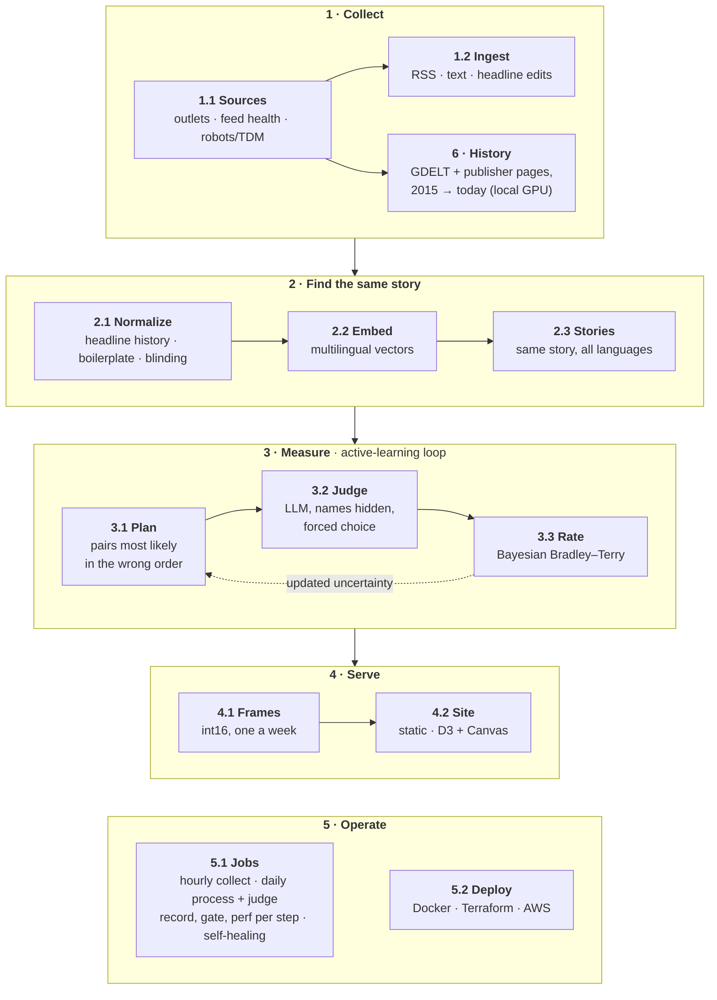
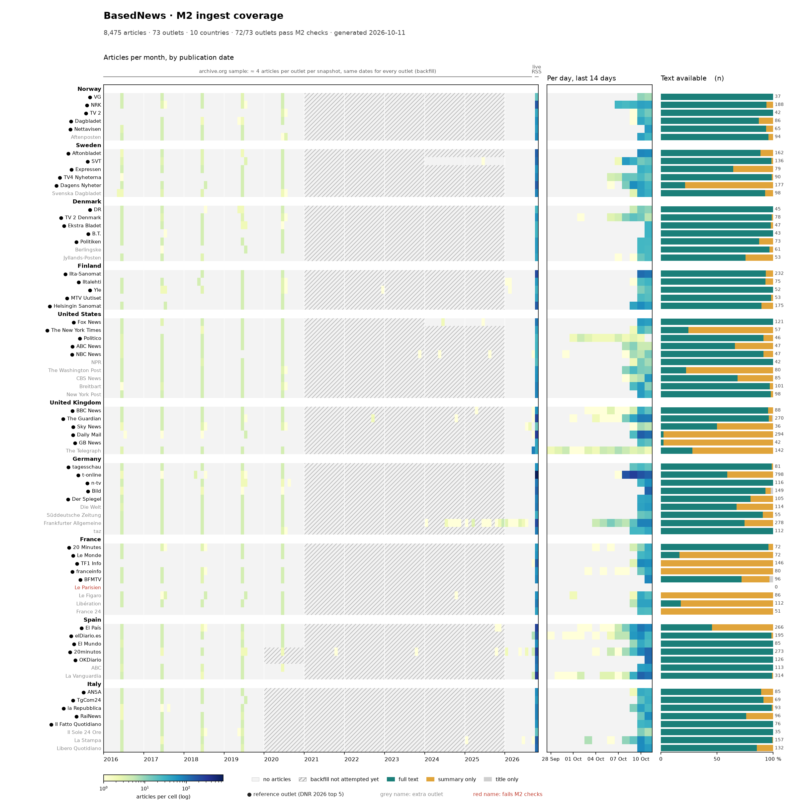
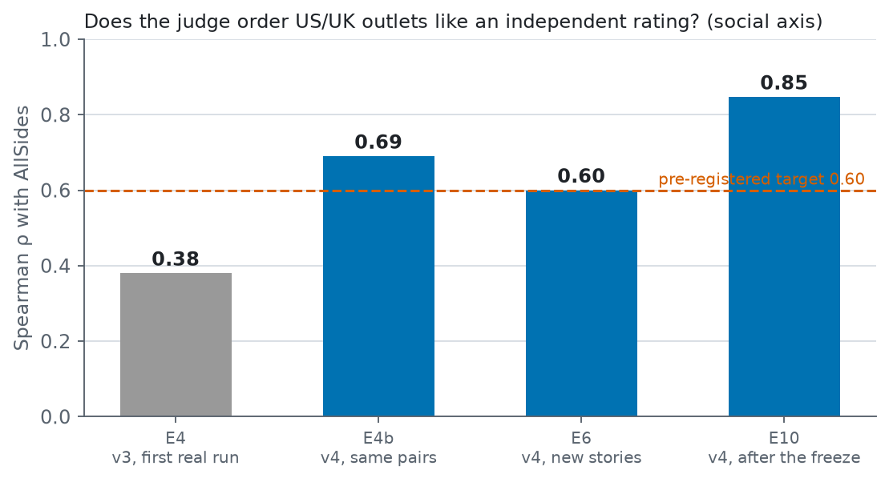
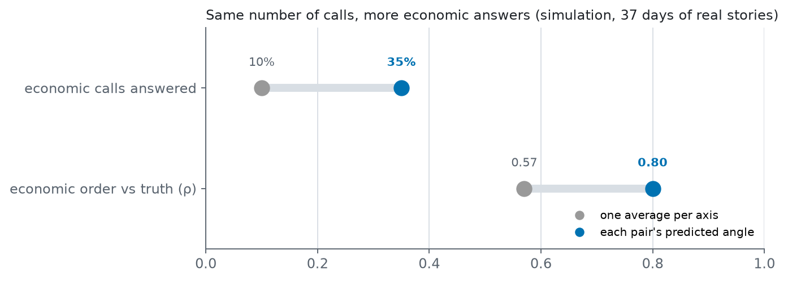
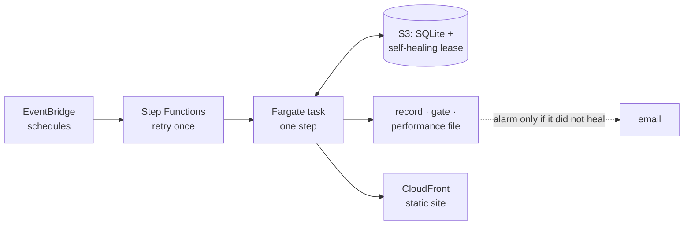
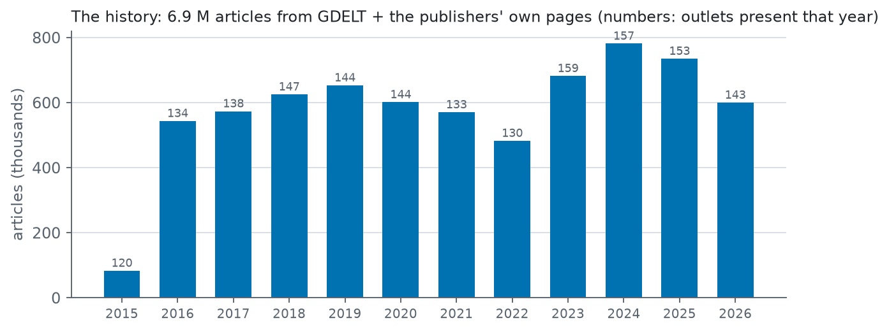
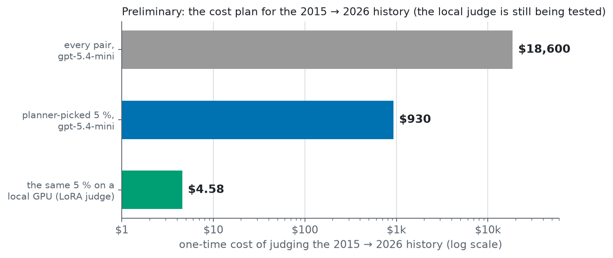
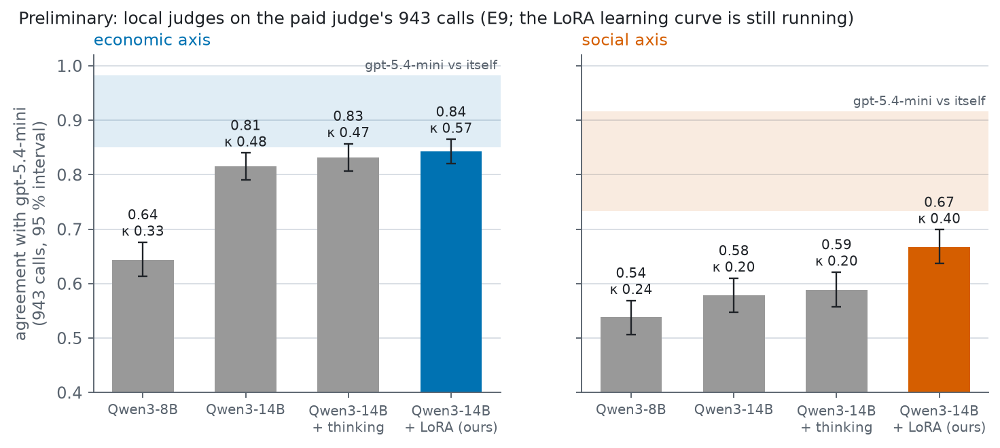
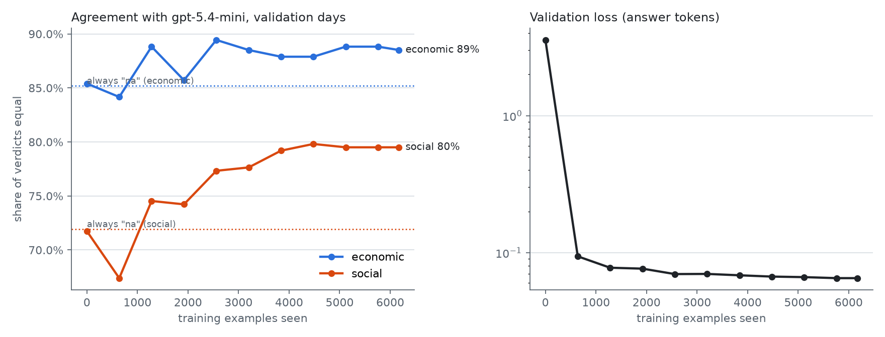
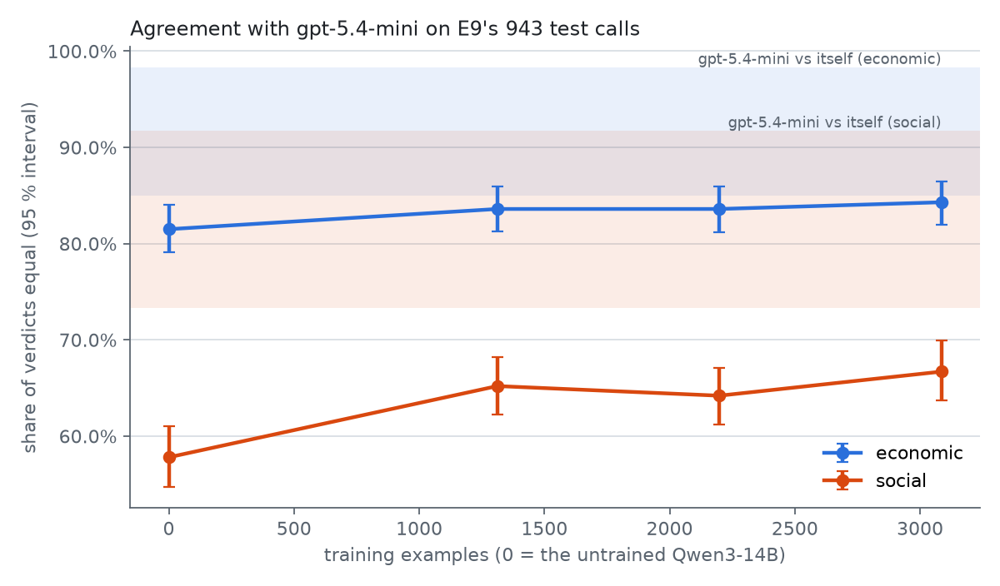

# BasedNews — where does your news lean, and how sure can we be?

[](https://github.com/axelsolhall/BasedNews/actions/workflows/ci.yml)

Two papers report the same budget. One calls it **"tax relief for families"**, the other **"tax cuts for the
rich"**. Neither is lying — but they are leaning. **BasedNews measures which way, for the major news outlets of 41
countries, from 2015 to today, and how sure it can be.**

**Live: [basednews.info](https://basednews.info)** — eleven years of positions, and a new point every day.


An LLM judge reads **two articles about the same event**, with the outlets' names hidden, and says which one frames it
further economically right and further socially conservative. Each verdict nudges the two outlets' scores — a Bayesian
Bradley–Terry update, Elo-like but with an uncertainty per outlet — and a planner picks the next comparisons where the
order of two outlets is still most in doubt.

| | |
|---|---|
| **Scale** | 11.4 M historical articles (GDELT + publisher pages, 2015-11 → 2026-10) and ≈ 24,000 new ones a day · 228 outlets · 41 countries · 30 languages |
| **Verdicts** | 1.92 M on the history, judged on a gaming GPU by a fine-tuned open model; then daily on live news |
| **Shown** | an outlet once it has 5,000 comparisons, a country once its outlets together have — 168 outlets and all 41 countries today; the rest listed as inconclusive |
| **Running cost** | a few dollars a month: ≈ $1 of AWS compute, ≈ $2.50 of embeddings, ≤ $4.50 of live judging |
| **Engineering** | 230 tests, a quality gate on every pipeline step, Terraform-managed AWS, CI that ships but never changes infrastructure |

## Results

Do the positions agree with what others measured? On the outlets drawn on the site
([reports/threshold.md](reports/threshold.md); every outlet: [reports/external_check.md](reports/external_check.md)):

| Reference | What it rates | Agreement (Spearman ρ, 95 % interval) |
|---|---|---|
| AllSides 2024 | US/UK outlets' bias, expert + reader ratings | **+0.84** [+0.48, +0.97], 10 outlets |
| Reuters Institute DNR 2017 | each outlet's audience, self-placed left–right, within its country | **+0.52** [+0.15, +0.77], 57 outlets in 11 countries |
| Chapel Hill Expert Survey 2019 | each country's party positions, by vote share | not significant (countries, not outlets) |

| What it took | |
|---|---|
| a judge for eleven years of news | **$3.58** of paid labels taught an open model (Gemma 4 12B + LoRA) to judge like gpt-5.4-mini: social-axis agreement κ 0.21 → **0.49**, at ≈ **51,000 calls an hour** on one RTX 5080 — instead of ≈ $930 of API calls |
| the planner's aim | a per-pair model predicts which stories even have an economic angle (AUC **0.90**), so calls go where an answer is possible |
| the site | the whole history at **60 frames a second**, from 0.9 MB of precomputed frames |

<details>
<summary><b>Read with care — what agreement can and cannot mean</b></summary>

BasedNews measures the **framing of the same event**, not which stories an outlet picks, nor its audience; the
references include those, so agreement has a ceiling below 1, and a disagreement is something to explain, not to tune
away (A50). The minimum of 5,000 comparisons was fixed **after** seeing how agreement and the number of outlets change
with it ([reports/threshold.md](reports/threshold.md)): agreement is flat from 500 to 10,000 within overlapping
intervals; with every outlet drawn it is AllSides ρ +0.76, DNR ρ +0.35. Known biases: verdicts on 2015-11 → 2017-10
were asked with a non-random article order, and the judge favours the first article as more liberal ≈ 56 % of the
time ([reports/outliers](reports/outliers/README.md)); the New York Times' Chinese edition was removed from the NYT
(A81). The live days are judged by a different model (OpenAI) than the history (the fine-tuned Gemma), with the same
prompt.

</details>

## Highlights

- **Eleven years judged on a gaming GPU instead of ≈ $930 of API calls** — off-the-shelf open models abstained where
  the paid judge decided; a LoRA adapter on $3.58 of its verdicts closed much of the gap (§ 6).
- **Active learning that spends where the order is uncertain** — each call goes to the pair most likely in the wrong
  order, weighted by its predicted chance of having an angle at all, with a weekly minimum per outlet (§ 3).
- **Same-story matching across 30 languages at full volume** — exact average-linkage clustering whose memory grows with
  the close pairs instead of n² (§ 2).
- **Serverless operations for about a dollar of compute a month** — one container per step, the database in S3 behind
  a self-healing lease, a record and a quality gate per step, a cost kill switch (§ 5).
- **Method you can check** — experiments pre-registered and recorded whatever the outcome, tests pooled and blinded,
  85 written assumptions with what depends on each ([ASSUMPTIONS.md](ASSUMPTIONS.md); § Method).

**Stack:** Python 3.12 · NumPy/SciPy · SQLite · Parquet (pyarrow) · vLLM · Gemma 4 / Qwen3 + LoRA (PEFT) · OpenAI API ·
Qwen3-Embedding · D3 + Canvas · Docker · Terraform · AWS (ECS Fargate, Step Functions, EventBridge, S3, CloudFront) ·
GitHub Actions (OIDC).

---

# The whole story

Every step has one job, a typed contract, persisted output and **its own check** that runs in isolation, so a problem
can be traced to the step that causes it. Each section opens with what matters; **Details** holds the technical
record. `M1`…`M9` are the module IDs used in the code, [ASSUMPTIONS.md](ASSUMPTIONS.md) and
[BACKLOG.md](BACKLOG.md) (module index: [pipeline/README.md](pipeline/README.md)).



## 1 · Collect — 228 outlets, 41 countries, 30 languages

In each country the five largest online news brands in the Reuters Institute *Digital News Report* define where that
country stands; other outlets are extras (ADR-006). Every outlet is read hourly from its feeds. Publishers that opt out
of text and data mining, or block bots, are respected: they are judged on headline and summary only (ADR-007).

| | |
|---|---|
| outlets / countries / languages | 228 / 41 / 30 (205 in the reference set) |
| articles a day | ≈ 24,000 (ingest records, 2026-10-24 → 30) |
| cost of an hourly run on day 300 vs day 3 | the same: only the URLs in the current feeds are looked up (A63) |

<details>
<summary><b>Details: 1.1 Sources · 1.2 Ingest</b></summary>

### 1.1 Sources · `M1` · `pipeline/sources/`
- **Does:** keeps the outlet registry and checks each outlet: feeds alive, freshness, robots.txt and the W3C TDM
  opt-out.
- **In → out:** `data/outlets.json` (228 outlets, 41 countries, 30 languages) → `feed_health`.
- **Reference set:** in each country, the five largest online news brands in the Reuters Institute *Digital News
  Report 2026* define that country's position (A29; 205 outlets). Other outlets are extras. 195 outlets have a working
  feed; the rest are read from their front pages next (BACKLOG).
- **Policy:** publishers that opt out or block bots are read as headline + summary only (A10, A33). We never spoof a
  browser or solve a challenge.
- **Check:** `uv run python -m pipeline.sources.run && uv run python -m pipeline.sources.eval`

### 1.2 Ingest · `M2` · `pipeline/ingest/`
- **Does:**
  - reads RSS (and RSS 1.0) and skips known URLs before downloading — it looks up only the URLs in the current feeds,
    so a run costs the same on day 300 as on day 3 (A63);
  - extracts text (JSON-LD → trafilatura → summary, A19);
  - strips HTML, site notices and paywall pages (A38);
  - records a new headline when a known URL's headline changes (A34);
  - dates undated items by when they were first seen (A39).
- **In → out:** feeds → `articles`, `headlines`.
- **Check:** `uv run python -m pipeline.ingest.report` → the chart and tables below. `--samples 1` prints text
  snippets; `--readme` refreshes the table.



*The chart and the table below are the 10-country snapshot of 2026-10-11 (their history column is the archive.org
sample that the GDELT history has since replaced).* Left: articles per month; right: what the judge can read — orange
is policy, not a bug. Per-outlet detail: [`reports/m2_ingest.md`](reports/m2_ingest.md).

<!-- m2:begin -->
*Snapshot 2026-10-11, regenerated by `uv run python -m pipeline.ingest.report --readme`.*

| Country | Outlets (ref / all) | Articles | Last 72 h | Last 14 d | History years (of 10, mean) | Full text | Summary only | Dated | Pass |
|---|---:|---:|---:|---:|---:|---:|---:|---:|---:|
| Norway | 5 / 6 | 512 | 366 | 413 | 4.0 | 94 % | 6 % | 100 % | 6/6 |
| Sweden | 5 / 6 | 742 | 570 | 644 | 4.8 | 74 % | 26 % | 100 % | 6/6 |
| Denmark | 5 / 7 | 400 | 279 | 295 | 4.3 | 94 % | 6 % | 100 % | 7/7 |
| Finland | 5 / 5 | 587 | 508 | 508 | 4.0 | 93 % | 7 % | 100 % | 5/5 |
| United States | 5 / 10 | 724 | 510 | 537 | 5.3 | 78 % | 22 % | 100 % | 10/10 |
| United Kingdom | 5 / 6 | 872 | 639 | 701 | 4.5 | 47 % | 53 % | 100 % | 6/6 |
| Germany | 5 / 9 | 1,808 | 1,409 | 1,612 | 5.2 | 74 % | 26 % | 100 % | 9/9 |
| France | 5 / 9 | 715 | 590 | 598 | 3.3 | 24 % | 76 % | 100 % | 8/9 |
| Spain | 5 / 7 | 1,372 | 1,176 | 1,244 | 4.9 | 89 % | 11 % | 100 % | 7/7 |
| Italy | 5 / 8 | 743 | 611 | 627 | 4.0 | 92 % | 8 % | 100 % | 8/8 |
| **All** | 50 / 73 | **8,475** | 6,658 | 7,179 | 4.5 | 75 % | 25 % | 100 % | 72/73 |
<!-- m2:end -->

</details>

## 2 · Find the same story in 30 languages

Articles are embedded in one multilingual space and grouped into stories over a rolling 7-day window; a story covered
by two outlets gives a pair to compare. Choosing the embedding model taught the project's first method lesson — **a
test set chosen by one model decides the comparison** (F2):

| test | the model that chose the test pairs | result |
|---|---|---|
| E7: pairs sampled with the local MiniLM | MiniLM | MiniLM looked twice as good (recall 0.83 vs 0.42) |
| E7b: random anchors, both models' candidates pooled, labelled blind | neither | OpenAI ahead on every measure (AUC 0.965 vs 0.925) |
| E7, E7b: 512 vs all 1,536 dimensions | — | equal (AUC 0.963 vs 0.964), a third of the storage |

At full volume (≈ 170,000 articles in a window) the clustering ran out of memory; it was rewritten to work from close
pairs and running sums — **the same partitions, memory that grows with the close pairs instead of n²** (ADR-004).

<details>
<summary><b>Details: 2.1 Normalize · 2.2 Embed · 2.3 Stories</b></summary>

### 2.1 Normalize · `M3` · `pipeline/normalize/`
- **Does:**
  - **Renames and containers:** when one stored text appears under several headlines, decides by content whether it
    is one article that was renamed (any number of times → one article with a headline history) or a live-blog or
    news-list page. On a page, only the entry that matches it keeps the text (A34).
  - **Boilerplate:** removes paragraphs that repeat across an outlet's articles at the start or end, across different
    stories: footers, pop-ups, tip boxes, copyright lines. Repeats in the body text are kept (A40).
  - **Non-articles:** marks items that are not one article (multi-topic show pages, site pages, headline-only items)
    and drops consent walls (A38).
  - **Bounded:** reads the last 14 days (plus older copies of their texts), one outlet at a time, since every rule
    compares an outlet only with itself (A63).
  - **Blinding and genre:** removes the outlet's own name from titles (A42) and tags opinion pieces (A43).
  - **Article content is never shortened or rewritten**; only non-content is removed (A41).
- **In → out:** `articles` → `articles.canonical_id`, `kind`, `genre`, `headlines`. Removed texts are backed up, so
  every step can be reversed.
- **Check:** `uv run python -m pipeline.normalize.run`, then
  `uv run python -m pipeline.normalize.eval --samples 3` → `reports/m3_normalize.png`. The vectors it compares are
  cached by text, so a daily run only pays for new headlines (A56).

### 2.2 Embed · `M4` · `pipeline/embed/`
- **Does:** one multilingual vector per article. An article with several headlines gets the mean over its
  versions (A35).
- **Model:** OpenAI `text-embedding-3-small`, shortened to 512 dimensions (A56, ADR-011). It was chosen by E7b, a
  blind pooled test on our own stories where neither candidate picked the test pairs; 512 measured equal to the full
  1,536 at a third of the storage (E7). The local multilingual MiniLM stays as the baseline (`uv sync --group ml`).
- **Thresholds belong to the model:** each model has a calibrated profile, and a model without one refuses to run
  2.1 and 2.3 (A47, `pipeline.embed.calibrate`).
- **Cost:** ≈ $0.07–0.12 a day at 41 countries, inside the monthly AI cap, which the encoder enforces (A48).
- **Bounded:** reads its 14-day window in chunks of 900 articles (A63).
- **In → out:** canonical `articles` + `headlines` → `embeddings` (re-embedded when a new headline arrives).
- **Check:** `uv run python -m pipeline.embed.eval`: are an article's nearest neighbours the same story in other
  languages?

### 2.3 Stories · `M5` · `pipeline/events/`
- **Does:** time-aware average-linkage clustering over a rolling 7-day window (72 h window, 96 h decay, threshold
  0.56 from the model's profile; A20, ADR-004). Re-run daily: a later article joins its story and adds new pairs.
- **At scale:** computed exactly from the close pairs and running sums of distances, never the full distance matrix,
  so a full 41-country window (≈ 170 k articles) fits in ≈ 1.6 GB; identical partitions to the full method on real
  windows of 41,677 and 60,778 articles (ADR-004). A story with articles from two outlets gives a comparable pair
  (A02). Two outlets publishing the same headline and the same text is a known tie: it is kept but never sent to the
  judge (A44).
- **In → out:** `embeddings` → `event_members`, `same_text_pairs`.
- **Check:** `uv run python -m pipeline.events.eval` (precision and recall per threshold on the labelled pairs in
  `data/eval/`). The fair comparison of embedding models is E7b's pooled test
  (`uv run python -m pipeline.experiments.e7b analyse`).

</details>

## 3 · Measure — a judge, a model, and a planner

**The judge (3.2).** Four prompt versions, each changed because of a measured failure, never toward an expected answer:

| version | what was found | change |
|---|---|---|
| v1 "which is further right?" | picked the article with more material 71 % / 86 % of the time; the mirrored question agreed only 20 % on social | scores on a symmetric scale, "length is not evidence" |
| v2 scores −2…+2 | length lean gone, but decisive on only 22 % / 30 % of pairs | one forced choice per axis, no reasons, the question's direction random per call (decisive 38 % / 63 %) |
| v3 forced choice | on real stories (E4), "trusts police and authorities" in the conservative definition made straight news quoting officials read conservative | axis definitions rewritten; quoting officials, length, tone, language and order named as *not* a leaning |
| **v4** | | **locked** (E10: AllSides ρ 0.85 out of sample) |



**The model (3.3).** A Bayesian Bradley–Terry model with the judge's order bias as a parameter (ADR-001, ADR-003). One
article compared many times is not independent evidence (**F1**): 81–87 % of the variation in judged framing is
article-to-article within an outlet, so the model accounts for the articles behind each outlet.

**The planner (3.1).** Each call buys the comparison most likely to fix a wrong order (active learning, ADR-002). Most
calls cannot answer the economic question (a crime story, a football result), so a logistic model on the pair's vector
predicts which can before paying (**F3**, AUC 0.90 on live verdicts, A70). And no outlet is ever "done": each gets at
least five comparisons a week, however well it is known (A69).



<details>
<summary><b>Details: 3.1 Plan · 3.2 Judge · 3.3 Rate · the daily loop</b></summary>

### 3.1 Plan · `M6` · `pipeline/plan/`
- **Does:** scores every available story pair by the chance that its two outlets are in the wrong order, weighted by
  the pair's own predicted chance of an answer on each axis (A70), and keeps a weekly minimum of five comparisons per
  outlet (A69). Earlier versions scored the expected reduction in outlet and country variance per token, per article
  (A31, A32, A49, ADR-002, ADR-009).
- **Pairs:** like with like only (full text with full text, news with news, opinion with opinion; A21, A43). Known
  ties and pairs already judged with the current prompt are skipped. Article order is random (A04).
- **In → out:** stories + current positions + budget → comparison requests.
- **Check:** `uv run python -m pipeline.plan.angle eval --version v3,v4` (the angle model, out of fold); simulator:
  `uv run python -m pipeline.sim.eval_loop`.

### 3.2 Judge · `M7` · `pipeline/judge/`
- **Does:** one call per article pair answers both axes as a forced choice, with no reasons (prompt v4, A46).
  - **Questions:** "Which article's framing is more economically LEFT: A or B?" and "Which article's framing is more
    LIBERAL: A or B?". On a random half of calls the questions are worded RIGHT and CONSERVATIVE instead.
  - **"na"** only when the story has no angle on that axis (A32).
  - **Axis definitions** are in the system prompt: what each side centres, and what it treats as the problem and as
    the solution. The prompt also says what is *not* a leaning: quoting officials, length, tone, language, order.
    Full text in [`pipeline/judge/prompt.py`](pipeline/judge/prompt.py).
- **Input:** the whole article, never shortened (A41); the latest headline plus earlier versions (A36); the outlet's
  own name masked (A42).
- **Models:** live, `gpt-5.4-mini` with low reasoning effort (A11, A45); for the history, Gemma 4 12B with a LoRA
  adapter trained on gpt-5.4-mini's verdicts, on a local GPU (E11, E13, A65, A73). Every call, verdict, token and cent
  is stored with the prompt version (`judge_calls`, `judgments`, `api_usage`; A48).
- **Full archive of every paid call (A51):** the exact request with the rendered articles, the provider's full
  response (model snapshot, fingerprint, token breakdown), timing, retries and failures, and what the planner knew
  when it picked the pair. Later analyses never have to buy a call again. Check: `uv run python -m pipeline.judge.calllog`.
- **The site's daily example (A85):** one more call a day on the top story, asked also for its reasons (prompt v4r) —
  shown, never measured.
- **Check:** `uv run python -m pipeline.judge.eval --pairs 60` → `reports/m7_judge_eval_v4.md`: order swap,
  test–retest and the mirrored question (A28); first-shown and length lean; identical pairs; cost per call. Run it
  after any prompt or model change; `--prompt v3` compares with an older version.

### 3.3 Rate · `M8` · `pipeline/rate/`, `pipeline/history/positions.py`
- **Does:** Bayesian Bradley–Terry with a judge order-bias term β and a per-comparison sharpness (full text vs
  summary). Each outlet carries a position and an uncertainty per axis; every verdict moves only its two outlets
  (A74), and uncertainty regrows by a daily drift when an outlet goes unmeasured (A67).
- **Articles, not just outlets (F1, ADR-009):** a hierarchical variant places each article around its outlet with
  spreads estimated from the data; past 300 judged articles it runs on sparse algebra with identical numbers —
  ≈ 60,000 articles in about a second, where the dense fit would need 29 GB per step (A66).
- **Countries:** a country is the comparison-weighted mean of its reference outlets (A08).
- **In → out:** `judgments` → per-day positions (mean, sd per outlet and axis) and country positions.
- **Check:** `uv run python -m pytest -q` (recovery tests); coverage under article reuse:
  `uv run python -m pipeline.sim.eval_articles` (E5).

### The daily loop · `pipeline/measure/live.py` (A82)
- Each morning the `judge` job carries the history's final state forward: positions grow by the days since, the
  planner picks today's pairs until the day's budget ($0.15), each verdict moves its two outlets, and the day's
  positions are saved and exported to the site. `--dry-run` prints the state and the first picks without a call.

</details>

## 4 · Serve — the map

The site is static files on a CDN — no API server (ADR-010) — and only plays precomputed frames (A82). Every country
and outlet sits on **one global scale**: open a country and its outlets are exactly where they are on the world view.
An outlet appears once it has 5,000 comparisons and a country once its outlets together have, each from the week it
crosses the line — so the map fills in as the evidence does (A83).

| | |
|---|---|
| frames | int16 · x, y, sd x, sd y per entity · one a week since 2016 + the latest day |
| size | 0.9 MB for eleven years; history files named by content and cached for good |
| speed | 60 frames a second (measured in Chrome) |

<details>
<summary><b>Details: 4.1 Frames · 4.2 Site</b></summary>

### 4.1 Frames · `pipeline/export/frames.py` (A82, A83)
- **Does:** positions → int16 frames: per entity (countries, then outlets) x, y, sd x, sd y around one fixed point
  (the average country on the history's last day); one frame a week plus the latest day. History: one file per year,
  named by its content, and a `manifest.json` (entities with the week each enters, the threshold, inconclusive
  outlets, the agreement with outside ratings) — committed in `site/data/history/`. Live: `live.json` +
  `live-<hash>.bin`, rewritten by the daily judge job.
- **Check:** `uv run python -m pipeline.export.frames check site/data/history` decodes every file and prints what it
  holds; `tests/test_frames.py`.

### 4.2 Site · `site/`
- **Does:** a scroll-told map: the countries' paths since 2016, a region filter, a country's own outlets, a real
  judgment (one a day, A85), then free exploration (plane, map, table, timeline), and the agreement with outside
  ratings. D3 + Canvas, no build step; trails are sampled once and drawn in a dozen strokes per line.
- **Run:** `python3 -m http.server -d site 4300` → http://127.0.0.1:4300. CI uploads `site/` on every push to main.
- **Never serves article text** (A10): headlines and links only, in the judgment examples.

</details>

## 5 · Operate — live on AWS for about a dollar a month



Scheduled container jobs, the database in S3 behind a lease that heals itself when a task dies (ADR-012), a record, a
quality gate and a performance file for every step, and a cost kill switch. Every fix was sized for steady-state
volume, never by raising memory (A63) — when the database hit S3's 5 GiB single-upload limit, the answers were a
retention rule (old articles that can no longer change an outlet's order are dropped, the rest move to an append-only
Parquet lake; A79, A80) and a page size that stopped vector rows wasting half their pages (A84), not a bigger box.

| measured by the jobs themselves | |
|---|---|
| compute | ≈ $0.78 a month |
| peak memory | ≤ 18 % of the 4 GB limit, on every step |
| database | ≈ 3 GB after daily maintenance |
| OpenAI | ≈ $2.50 embeddings + ≤ $4.50 judging a month |

<details>
<summary><b>Details: 5.1 Jobs · 5.2 Deploy · costs</b></summary>

### 5.1 Jobs · `pipeline/job/`
- **Does:** `python -m pipeline.job <step|job>` runs a module's own `main()`, then its **gate**: a few numbers from
  the module's eval, each against one threshold (A53). It stops at the first step that fails, and every step leaves a
  **record**: commit, arguments, table counts before and after, the gate's numbers, the error and traceback (in
  `job_runs`, and as JSON). Logs are JSON lines. A paid step refuses to run without an explicit budget (A48).

  | Job | Steps | Schedule (UTC) |
  |---|---|---|
  | refresh | ingest | hourly |
  | process | normalize → embed → stories | daily 02:35 (A63) |
  | feeds | sources | daily |
  | judge | measure → showcase → export | daily 04:35, $0.15 budget (A58, A82, A85) |
  | maintenance | retention | daily 05:35 (A79, A80, A84) |

- **State:** the SQLite file lives in S3. A step takes a lease, downloads it, runs, and uploads it only if the step and
  its gate passed, the lease is still its own, and the stored file is still the version it downloaded (A55). A failed
  step leaves the stored database as it was, so the site keeps its last good data.
- **Self-healing (ADR-012, A62):** the lease is renewed every minute and taken over when silent for 5 min; a stopped
  task ends cleanly; the state machine retries a crashed step once; alarms fire only when it did not heal.
- **Performance (A64):** every step attempt writes its phases, CPU, peak memory against the limit and its cost —
  every minute while it runs. `uv run python -m pipeline.job perf --days 1` prints the report and a monthly projection.
- **Retention (A52, A79, A80, A84):** text and vectors are kept as long as a step can still read them; articles past
  the 7-day matching window that can no longer change an outlet's order are dropped; old unjudged articles move to the
  Parquet lake; verdicts, positions and records are archived for good. The VACUUM writes 16 KB pages, so 2 KB vector
  rows no longer fill a 4 KB page each.
- **Check:** `uv run python -m pytest -q tests/test_job.py tests/test_storage.py tests/test_retention.py`;
  `uv run python -m pipeline.job history`.

### 5.2 Deploy · `infra/`, `Dockerfile`, `.github/workflows/ci.yml`
- **Does:** one Docker image (arm64) for every step; Terraform for every AWS resource: S3 + CloudFront for the site
  (with its own domain through Cloudflare DNS), ECS Fargate tasks started by Step Functions on EventBridge schedules,
  alarms by email, and a kill switch that turns the schedules off if the month's AWS cost passes $15. GitHub Actions
  runs lint, tests, Terraform checks and a smoke test inside the built image on each push and, on main, ships the
  image and the site through narrow OIDC roles; it never changes infrastructure (A57).
- **Check:** `terraform -chdir=infra/main validate`; `uvx checkov -d infra --config-file infra/.checkov.yaml` (every
  skipped check has its reason); `docker compose run --rm job list`.

### Costs (per month)
AWS measured by the performance report (A64); OpenAI from the spend log (`api_usage`):

| | AWS | OpenAI |
|---|---|---|
| refresh (hourly collect) | ≈ $0.45 | — |
| process (daily) | ≈ $0.15 | ≈ $2.50 (embeddings) |
| feeds | ≈ $0.01 | — |
| judge (daily) | ≈ $0.10 | ≤ $4.50 ($0.15 a day) |
| storage, CDN, alarms | ≈ $0.50 (estimate) | — |

Caps: the app refuses AI calls past $12 a month (A48), OpenAI's own reload limit is $10 a month, and the AWS kill
switch fires at $15.

</details>

## 6 · History — eleven years on a gaming GPU

The product's must is change over time: every outlet since 2015-11. GDELT lists the URLs; each publisher's own page
gives headline and description — 11.4 M articles in all.



**The cost problem.** Every same-story pair over eleven years is ≈ 12 M judge calls: ≈ $18,600 with gpt-5.4-mini, or
≈ $930 for the planner's 5 %. The answer: the same calls on a local GPU, with an open model taught to judge like the
paid one.



**A local judge, in four steps.** Off-the-shelf models abstain on the social axis where the paid judge decides (E9,
F4). The prompt was locked out of sample first (E10). Then a LoRA adapter trained on **$3.58** of gpt-5.4-mini's
verdicts (E11) — and on a stronger base, Gemma 4 12B, it lifts social-axis agreement from κ 0.21 to **0.49**, with
outlet order on the social axis ρ 0.63 (E13). It served **1.92 M** verdicts at ≈ 51,000 calls an hour on one RTX 5080.



<details>
<summary><b>Details: the experiments behind the local judge · how the history is built</b></summary>

1. **Off-the-shelf models fail (E9, F4).** Qwen3-14B and -8B, with and without reasoning, abstain on the social axis
   where gpt-5.4-mini takes a side; reasoning first costs 50× the tokens and changes almost nothing.
2. **Lock the prompt before teaching it (E10).** Training freezes the prompt, so v4 was re-checked on stories collected
   after it was frozen ($1.00): AllSides ρ 0.85.
3. **Teach it (E11).** A LoRA adapter trained on 3,085 gpt-5.4-mini verdicts on history pairs ($3.58), sampled in
   batches of whole days that never overlap, with held-out validation days. On E9's 943 unseen test calls it doubles
   Qwen3-14B's social κ (0.20 → 0.40).
4. **Is the rest data or decision rule? (E12).** Trained on ⅓, ⅔ and all of the days, most of the gain comes with the
   first third; read from its probabilities with a cut for "no angle", it does no better: its misses are not hidden
   decisions (F5).
5. **A better base (E13).** The same recipe on Gemma 4 12B: econ κ 0.63, social κ 0.49, outlet order ρ 0.46 · 0.63 —
   the judge used for the history ([e13_results](docs/experiments/e13_results.md)).





*A side lesson:* the first speed test copied the paid model's call shape and measured 10,000 calls an hour; the real
call answers in 14 tokens with a cached prompt: 51,000. Measure the call the system will actually make.

### 6.1 How the history is built · `pipeline/history/` (A61)
- **Candidates** (`gdelt.py`): GDELT's GKG on BigQuery (the free sandbox) lists each outlet's URLs per day; a cheap
  pre-filter keeps up to 20 per outlet and day that mention entities other outlets mention too.
- **Pages** (`fetch.py`, `prefetch.py`): each publisher's own page gives headline, description and publish time —
  headline + snippet only, never the full text (A10); one request at a time per site, ≥ 1 s apart, robots.txt
  respected; a month at a time, resumable.
- **Replay** (`replay.py`): a 7-day window moves day by day through the timeline with the live modules — embed,
  stories, plan, judge — so every day is measured the way live measures today. Verdicts are stored once; positions are
  rebuilt from them (`replay rebuild`) without the GPU.
- **Local, not paid:** the judge and the embeddings run on the maintainer's gaming PC (RTX 5080) behind an
  OpenAI-compatible server ([docs/LOCAL_LLM.md](docs/LOCAL_LLM.md), A65), each tested against live's models first.
- **Coverage:** every outlet compared at least five times a week (A69), each pair's own chance of an answer (A70).
- **Positions over time** (A67, A74): each outlet on a random walk whose drift is chosen by the evidence — a run of odd
  articles cannot undo years of verdicts, and uncertainty regrows when an outlet goes unmeasured. Step by step:
  [docs/HISTORY.md](docs/HISTORY.md).

</details>

## Experiments — what was tested, and what it changed

Thirteen experiments, most pre-registered (criteria fixed and hashed before the run), every one recorded whatever the
outcome. The ones that changed the design:

| | changed |
|---|---|
| E4 → E4c: first real measurement, then why single outlets disagreed | the social-axis definition (prompt v4); article reuse found → F1, the hierarchical model |
| E7 → E7b: embeddings, first with a biased test, then a blind pooled one | OpenAI @512 adopted; F2 |
| E9 → E13: can an open model replace the paid judge for the history? | off-the-shelf no (F4); LoRA on $3.58 of labels yes, on Gemma 4 12B (F5) |

<details>
<summary><b>Details: every experiment</b></summary>

| ID | Question | What it changed | Record |
|---|---|---|---|
| E1–E3 | Does cost-aware selection save tokens? (simulation; E3 replays real stories with simulated verdicts) | planner design | [METHOD.md](docs/METHOD.md) |
| E4 | First real measurement, $2, 10 countries: does the judge reproduce known orderings (AllSides ratings, within-country contrasts)? | social-axis definition rewritten → prompt v4 | [e4_results](docs/experiments/e4_results.md) |
| E4b | The same US/UK pairs re-judged with prompt v4 | v4 adopted | [e4b_results](docs/experiments/e4b_results.md) |
| E4c | Why did single outlets disagree? Respecting noise, no prompt tuning toward expected answers | found article reuse → F1, hierarchical model | [e4c_diagnosis](docs/experiments/e4c_diagnosis.md) |
| E5 | Simulation: does reusing articles break the flat model's intervals? | hierarchical model adopted (ADR-009) | [e5_article_effects](reports/e5_article_effects.md) |
| E6 | Fresh stories with v4, the hierarchical model and the article-aware planner | repeated out of sample (E10) | [e6_results](docs/experiments/e6_results.md) |
| E7 | OpenAI embeddings for story matching: 512 vs 1536 dimensions | 512 is enough; its MiniLM comparison was invalid (test set chosen by MiniLM) and withdrawn | [e7_results](docs/experiments/e7_results.md) |
| E7b | The unbiased re-test: random anchors, both models' top candidates pooled, labelled blind | OpenAI @512 adopted for embeddings, story threshold 0.56 | [e7b_results](docs/experiments/e7b_results.md) |
| E8 | Local embeddings for the history: three open models vs live's OpenAI @512, pooled and blind like E7b | Qwen3-Embedding for the history | [e8_prereg](docs/experiments/e8_prereg.json) |
| E9 | A local judge for the history: does an open-weights model answer like gpt-5.4-mini, as often as gpt-5.4-mini agrees with itself? | none valid on the social axis (they abstain where it decides) → F4, E11 | [e9 report](reports/e9.md) |
| E10 | Prompt v4 out of sample on fresh US/UK stories, before training locks it ($1.00) | target met (AllSides ρ 0.85, 12 outlets) → v4 locked | [e10 report](reports/e10.md) |
| E11 | A local judge trained on 3,085 gpt-5.4-mini verdicts (LoRA, $3.58), tested with E9's harness; learning curve on ⅓, ⅔, all of the data | social κ 0.20 → 0.40; flat after ⅓ → F5 | [e11_results](docs/experiments/e11_results.md) |
| E12 | The LoRA judge read from its probabilities: does a cut for "no angle", tuned on validation days, recover its misses? | no: misses become inventions and flips → F5 | [e11_results](docs/experiments/e11_results.md) |
| E13 | The same recipes on other bases, Gemma 4 12B among them | Gemma 4 12B + LoRA on ⅓ of the days: social κ 0.49 → the history's judge | [e13_results](docs/experiments/e13_results.md) |

A50 states what is measured: framing of the **same event**, not which stories an outlet chooses to cover. External
ratings include both, so agreement with them has a ceiling below 1. Disagreement is something to explain, not a
target to tune toward.

</details>

## Method — five findings, six habits

| | finding |
|---|---|
| **F1** | Measure outlets over their articles: one article compared many times is not independent evidence. |
| **F2** | A test set chosen by one model decides the comparison: pool and blind it. |
| **F3** | Most calls cannot answer the economic question — and a story's vector says in advance which can. |
| **F4** | Off-the-shelf local judges are cautious where the paid judge decides: a boundary to teach, not a lack of size. |
| **F5** | $3.58 of the paid judge's verdicts doubles a local model's social κ, and then it flattens. |

**Six habits that came out of it.** Pre-register, then look. Pool and blind any test where a candidate could have
chosen the data. Measure outlets over their articles. Count what a call can tell, not just what it costs. Use the paid
judge's agreement with itself as the ceiling for any replacement. Size every fix for steady state, and measure the
workload the system will really run.

<details>
<summary><b>Details: the findings, with their evidence</b></summary>

**F1 — measure outlets over their articles.** On real verdicts, 81–87 % of the variation in judged framing is
article-to-article within an outlet (ICC 0.13–0.19). A flat model overstates certainty and lets single articles decide
an outlet's position. A hierarchical model with article effects fixes this, and active selection prefers new articles.

**F2 — a test set chosen by one model decides the comparison.** Labelled pairs sampled with MiniLM made MiniLM look
twice as good as OpenAI's embeddings (E7); on a blind pooled test that neither model chose, OpenAI was ahead on every
measure (E7b). 512 dimensions matched the full 1,536 on both tests.

**F3 — a story's vector says in advance whether the economic question can be answered.** The judge finds an economic
angle in 14 % of pairs; a logistic model on the pair's vector predicts it with AUC 0.90 out of fold, and at the same
budget it raised the share of answered economic calls from 10 % to 35 % in simulation.

**F4 — off-the-shelf local judges are cautious where the paid judge decides.** On the social axis they say "no angle"
in 81–86 % of pairs where gpt-5.4-mini takes a side in about half; reasoning first costs 50× the tokens and changes
almost nothing.

**F5 — $3.58 of the paid judge's verdicts doubles a local model's social κ, and then it flattens.** The first third of
the data gives most of the gain; validation loss keeps falling after agreement stops moving. Its remaining misses are
not near-decisions, and agreement with the teacher is the wrong yardstick for where to draw the line: with cheap local
calls, the judge to keep is the one whose verdicts separate outlets best.

Evidence, limits and how to reproduce: [docs/FINDINGS.md](docs/FINDINGS.md).

</details>

## Decisions — the standard, and what was explored instead

Eighteen design choices where the project tried something other than the usual default, each with a record. The ones
that shaped it most: **Bayesian Bradley–Terry instead of Elo** (uncertainty per outlet), **forced choice without
reasons instead of scores** (decisive, cheaper), **a self-healing lease in S3 instead of a managed database**, and
**a LoRA-trained local judge instead of paid calls** for the history.

<details>
<summary><b>Details: the decision table</b></summary>

| Step | Choice | Standard / baseline | Explored here | Record |
|---|---|---|---|---|
| 3.3 | Ranking | Elo | Bayesian Bradley–Terry + judge bias + per-comparison sharpness | [ADR-001](docs/decisions/ADR-001-ranking-model.md) |
| 3.3 | Unit of evidence | each comparison independent | outlets measured over their articles (hierarchical, spreads estimated) | [ADR-009](docs/decisions/ADR-009-article-effects.md) |
| 3.1 | Selection | random / info-gain | the pairs most likely in the wrong order, weighted by their chance of an answer | [ADR-002](docs/decisions/ADR-002-active-selection.md) |
| 3.2 | Judge answer | score on a scale, with reasons | forced choice per axis, no reasons, question wording randomised | A46 in [ASSUMPTIONS.md](ASSUMPTIONS.md) |
| 3.2 | LLM order bias | ask both orders (2×) | estimate β | [ADR-003](docs/decisions/ADR-003-judge-order-bias.md) |
| 2.3 | Clustering | threshold + components | average linkage, time-aware | [ADR-004](docs/decisions/ADR-004-event-clustering.md) |
| 2.2 | Embedding model | a benchmark score, or a test labelled from the current model | blind pooled test on our own stories; 512 of 1,536 dimensions; vectors cached by text | [ADR-011](docs/decisions/ADR-011-embeddings.md) |
| 4 | Scale | absolute labels | relative positions, one global scale | [ADR-005](docs/decisions/ADR-005-relative-scale.md) |
| 1.1 | Outlet set | hand-picked | Reuters DNR reach, two tiers | [ADR-006](docs/decisions/ADR-006-reference-set.md) |
| 1.1–1.2 | Scraping | take everything | robots.txt + TDM opt-outs + bot blocks respected | [ADR-007](docs/decisions/ADR-007-text-policy.md) |
| 6 | History | commercial archives | GDELT URLs + each publisher's own page (the Wayback sample was superseded) | [ADR-008](docs/decisions/ADR-008-history.md), A61 |
| 5 | Hosting | always-on API server + managed database | scheduled jobs with a gate per step, static site, small hot database in S3, CI that cannot change infrastructure | [ADR-010](docs/decisions/ADR-010-deployment.md) |
| 5 | One writer, no operator | managed database, or DynamoDB locks | a lease in S3 with conditional writes, fencing, clean stops and retries; alarms on lack of success | [ADR-012](docs/decisions/ADR-012-self-healing.md) |
| 2.3 | Clustering at scale | the full distance matrix (n²) | exact average linkage from close pairs and running sums | [ADR-004](docs/decisions/ADR-004-event-clustering.md) |
| 6, 3.2 | History judge | a paid API (≈ $930 at 5 %) | an open-weights model on a local GPU, LoRA-trained on $3.58 of the paid judge's verdicts, validated before use | A65, E9–E13 |
| 3.1 | Relevance per call | one average chance of an answer | each pair's own chance, learned from the judge's past answers | A70, F3 |
| 3.1 | Coverage | spend where uncertainty is highest | plus a weekly minimum per outlet, so no outlet is ever "done" | A69 |
| 5 | Retention | a fixed time window | delete exactly what no step can read again; archive verdicts for good | A52, A79, A80 |

All working assumptions are in [ASSUMPTIONS.md](ASSUMPTIONS.md), each with what depends on it and how to test it.
Human sign-offs per stage are in [VERIFY.md](VERIFY.md).

</details>

## Run it

```bash
cp .env.example .env                       # add OPENAI_API_KEY; .env is never committed
uv sync && uv run python -m pytest -q      # dependencies + the tests CI runs on every push
python3 -m http.server -d site 4300        # the site on :4300, from the committed history frames
```

<details>
<summary><b>Details: every command — the pipeline, single modules, the history, the image</b></summary>

`make help` lists shortcuts for the common ones (`make test`, `make check`, `make site`, `make image`).

```bash
# the pipeline through the job runner: one record + one gate per step, stops at the first failure (5.1)
uv run python -m pipeline.job list                                  # steps and jobs
uv run python -m pipeline.job refresh                               # ingest → normalize → embed → stories (embeddings ≈ cents)
uv run python -m pipeline.job measure --budget-usd 0.15             # 3: one live day: plan → judge → positions (paid, capped)
uv run python -m pipeline.job export                                # 4.1 live frames for the site
uv run python -m pipeline.job retention                             # A52 dry run: what would be archived and deleted
uv run python -m pipeline.job history                               # what ran, what failed, why
uv run python -m pipeline.job perf --days 1                         # time, CPU, peak memory vs limit, cost per step (A64)

# single modules and their checks
uv run python -m pipeline.measure.live --dry-run                    # today's state, candidates and picks, no calls
uv run python -m pipeline.measure.showcase --dry-run                # the day's example: story and pair, no call (A85)
uv run python -m pipeline.judge.eval --pairs 60                     # 3.2 judge reliability (after any prompt/model change)
uv run python -m pipeline.signoff --stage collect                   # stage sign-off scorecard
uv run python -m pipeline.history.llm_check --db data/history/history.sqlite   # the local judge: reachable, key, real speed (A65)

# the history and its experiments (docs/HISTORY.md: the full runbook)
PYTHONPATH=. uv run python -m pipeline.history.replay rebuild          # every day's positions from the stored verdicts (no GPU)
PYTHONPATH=. uv run python -m pipeline.history.external_check         # positions vs DNR, AllSides, CHES → reports/
PYTHONPATH=. uv run python -m pipeline.history.threshold              # A83: outlets drawn vs agreement → reports/threshold.md
PYTHONPATH=. uv run python -m pipeline.export.frames history          # the site's history frames → site/data/history
uv run python -m pipeline.experiments.e9 analyse                    # local judges vs gpt-5.4-mini → reports/e9.md
uv run python -m pipeline.plan.angle eval --version v3,v4           # the per-pair angle model, out of fold (F3)
PYTHONPATH=. uv run python scripts/plot_e11.py                      # LoRA training and learning-curve figures

# the production image, locally
docker compose run --rm job list                                    # same image as on AWS; data/state stands in for S3
```

</details>

## Status

Live since November 2026 at [basednews.info](https://basednews.info): hourly collection, daily matching and judging
from the history's final state, a daily example on the site, and maintenance that keeps the database small. Open items
are in [BACKLOG.md](BACKLOG.md) and [VERIFY.md](VERIFY.md).
