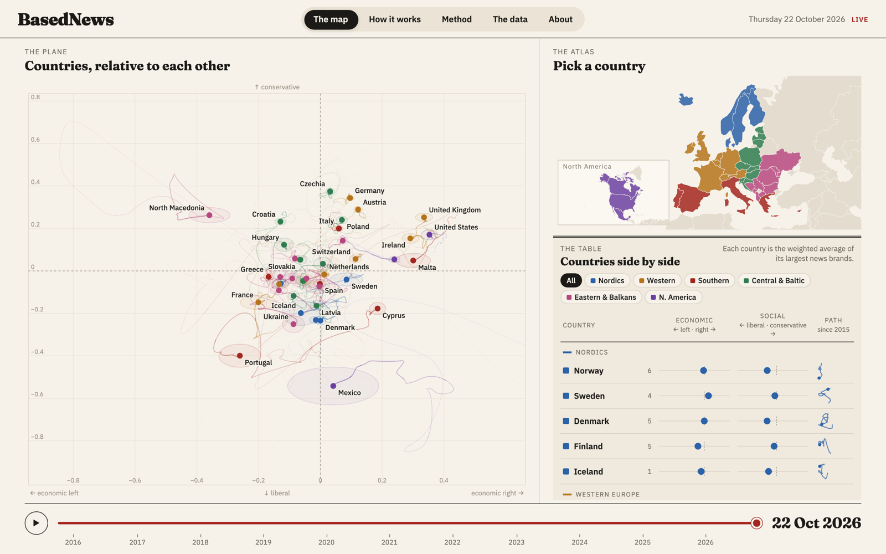
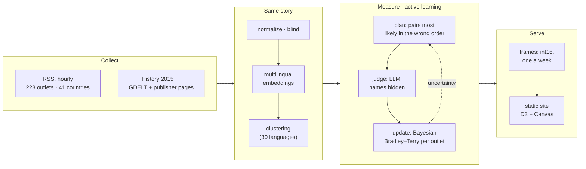

# BasedNews — where does your news lean, and how sure can we be?

[](https://github.com/axelsolhall/BasedNews/actions/workflows/ci.yml)

Two papers report the same budget. One calls it **"tax relief for families"**, the other **"tax cuts for the
rich"**. Neither is lying — but they are leaning. **BasedNews measures which way, for the major news outlets of 41
countries, from 2015 to today, and how sure it can be.**

**Live site: https://d1tb6ny2awbq5m.cloudfront.net** — eleven years of positions, and a new point every day.



An LLM judge reads **two articles about the same event**, with the outlets' names hidden, and says which one frames it
further economically right and further socially conservative. Each verdict nudges the two outlets' scores — a Bayesian
Bradley–Terry update, Elo-like but with an uncertainty per outlet — and a planner picks the next comparisons where the
order of two outlets is still most in doubt. Positions are relative: outlets to each other, never to an absolute
political centre.

| | |
|---|---|
| **Scale** | 11.4 M historical articles (GDELT + publisher pages, 2015-11 → 2026-10) and ≈ 24,000 new ones a day · 228 outlets · 41 countries · 30 languages |
| **Verdicts** | 1.92 M on the history, judged on a gaming GPU by a fine-tuned open model; then daily on live news |
| **Shown** | 168 outlets with at least 5,000 comparisons each; the other 60 are listed as inconclusive |
| **Running cost** | a few dollars a month: ≈ $1 of AWS compute, ≈ $2.50 of embeddings, ≤ $4.50 of live judging |
| **Engineering** | 228 tests, a gate per pipeline step, Terraform-managed AWS, CI that ships but never changes infrastructure |

## Results

Do the positions agree with what others measured? Compared with three outside references
([reports/threshold.md](reports/threshold.md); all outlets: [reports/external_check.md](reports/external_check.md)), on the outlets drawn on the site:

| Reference | What it rates | Agreement (Spearman ρ, 95 % interval) |
|---|---|---|
| AllSides 2024 | US/UK outlets' bias, expert + reader ratings | +0.84 [+0.48, +0.97], 10 outlets |
| Reuters Institute DNR 2017 | each outlet's audience, self-placed left–right, within its country | +0.52 [+0.15, +0.77], 57 outlets in 11 countries |
| Chapel Hill Expert Survey 2019 | each country's party positions, by vote share | not significant (countries, not outlets) |

**Read with care.** BasedNews measures the **framing of the same event**, not which stories an outlet picks, nor its
audience; the references include those, so agreement has a ceiling below 1, and a disagreement is something to
explain, not to tune away. Outlets with few comparisons are not drawn: the minimum (5,000) was fixed **after**
seeing how agreement and the number of outlets kept change with it ([reports/threshold.md](reports/threshold.md)) —
agreement is flat from 500 to 10,000 within overlapping intervals; with every outlet drawn it is AllSides ρ +0.76,
DNR ρ +0.35. Known biases: verdicts on 2015-11 → 2017-10 were asked with a non-random article order,
and the judge favours the first article as more liberal ≈ 56 % of the time
([reports/outliers](reports/outliers/README.md)); the New York Times' Chinese edition was removed from the NYT (A81).
The live days are judged by a different model (OpenAI) than the history (a fine-tuned Gemma), with the same prompt.

## How it works



Every step is a module with one job, a typed contract, persisted output and **its own check** (an eval command and a
quality gate in production), so a problem points to the step that causes it. Module by module, with experiments and
decisions: [docs/PIPELINE.md](docs/PIPELINE.md).

## Engineering highlights

- **Eleven years judged on a gaming GPU instead of ≈ $930 of API calls.** Off-the-shelf open models abstained where
  the paid judge decided (E9); a LoRA adapter trained on **$3.58** of gpt-5.4-mini's verdicts lifted agreement with it
  on the hard (social) axis from κ 0.21 (Qwen3-14B as is) to 0.49 (Gemma 4 12B + LoRA) (E11, E13), and vLLM on an
  RTX 5080 served ≈ 51,000 judge calls an hour. The replay
  moves a 7-day window through 2015 → 2026 with the live modules, so history and today are measured the same way.
- **Active learning that spends where the order is uncertain.** The planner scores every candidate pair by the chance
  its two outlets are in the wrong order, weighted by the pair's own predicted chance of having an angle at all (a
  model on the story's vector, AUC 0.90 for the economic axis), keeps a weekly minimum per outlet, and stops at the
  day's budget.
- **Same-story matching across 30 languages at full volume.** Exact average-linkage clustering computed from close
  pairs and running sums, so memory grows with the close pairs instead of n² (ADR-004); embeddings cached by text.
- **Serverless operations for about a dollar of compute a month.** EventBridge → Step Functions → Fargate, one
  container per step; the SQLite database lives in S3 behind a self-healing lease with fencing and conditional writes
  (ADR-012); every step leaves a record, a quality gate and a performance file; a cost kill switch. When the database
  hit S3's 5 GiB single-upload limit, the fix was a retention rule — articles past the matching window that can no
  longer change an outlet's order are deleted, the rest leave the hot database for an append-only Parquet lake (A79,
  A80) — not a bigger box.
- **A site that only plays files.** Positions are precomputed into int16 frames (2 kB a week for every outlet and
  country); history files are named by their content and cached for good, the live file is rewritten daily. Trails
  are sampled once and drawn in a dozen strokes per line instead of one per segment.
- **Method you can check.** Experiments pre-registered and recorded whatever the outcome; tests pooled and blinded
  where a candidate could have chosen the data (a test set picked by one model made it look twice as good, F2); ~80
  written assumptions, each with what depends on it and how to test it ([ASSUMPTIONS.md](ASSUMPTIONS.md));
  findings in [docs/FINDINGS.md](docs/FINDINGS.md).

**Stack:** Python 3.12 · NumPy/SciPy · SQLite · Parquet (pyarrow) · vLLM · Gemma 4 / Qwen3 + LoRA (PEFT) · OpenAI API ·
Qwen3-Embedding · D3 + Canvas · Docker · Terraform · AWS (ECS Fargate, Step Functions, EventBridge, S3, CloudFront) ·
GitHub Actions (OIDC).


## Run it
`make help` lists shortcuts for the common ones (`make test`, `make check`, `make site`, `make image`).

```bash
cp .env.example .env                                                # add OPENAI_API_KEY; .env is never committed
uv sync && uv run python -m pytest -q                               # dependencies + unit tests (CI runs these on every push)

# the pipeline through the job runner: one record + one gate per step, stops at the first failure (5.1)
uv run python -m pipeline.job list                                  # steps and jobs
uv run python -m pipeline.job refresh                               # ingest → normalize → embed → stories (embeddings ≈ cents)
uv run python -m pipeline.job measure --budget-usd 0.15             # 3: one live day: plan → judge → positions (paid, capped)
uv run python -m pipeline.job export                                # 4.1 live frames for the site
uv run python -m pipeline.job retention                             # A52 dry run: what would be archived and deleted
uv run python -m pipeline.job history                               # what ran, what failed, why
uv run python -m pipeline.job perf --days 1                         # time, CPU, peak memory vs limit, cost per step (A64)

# single modules and their checks
uv run python -m pipeline.measure.live --dry-run                    # today's state, candidates and picks, no calls
uv run python -m pipeline.judge.eval --pairs 60                     # 3.2 judge reliability (after any prompt/model change)
uv run python -m pipeline.signoff --stage collect                   # stage sign-off scorecard
uv run python -m pipeline.history.llm_check --db data/history/history.sqlite   # the local judge: reachable, key, real speed (A65)

# the history and its experiments (docs/HISTORY.md: the full runbook)
PYTHONPATH=. uv run python -m pipeline.history.replay rebuild          # every day's positions from the stored verdicts (no GPU)
PYTHONPATH=. uv run python -m pipeline.history.external_check         # positions vs DNR, AllSides, CHES → reports/
PYTHONPATH=. uv run python -m pipeline.history.threshold              # A83: outlets drawn vs agreement → reports/threshold.md
PYTHONPATH=. uv run python -m pipeline.export.frames history          # the site's history frames → site/data/history
uv run python -m pipeline.experiments.e9 analyse                    # local judges vs gpt-5.4-mini → reports/e9.md
uv run python -m pipeline.experiments.e11 status                    # training verdicts: batches, days, outlets, spend
uv run python -m pipeline.plan.angle eval --version v3,v4           # the per-pair angle model, out of fold (F3)
PYTHONPATH=. uv run python scripts/plot_e11.py                      # LoRA training and learning-curve figures

# the production image and the site, locally
docker compose run --rm job list                                    # same image as on AWS; data/state stands in for S3
python3 -m http.server -d site 4300                                 # the site :4300 (history frames; live ones in prod)
```
