# BasedNews — where does your news lean, and how sure can we be?

[](https://github.com/axelsolhall/BasedNews/actions/workflows/ci.yml)

Two papers report the same budget. One calls it **"tax relief for families"**, the other **"tax cuts for the
rich"**. Neither is lying — but they are leaning. **BasedNews measures which way, for the major news outlets of 41
countries, and how sure we can be.**

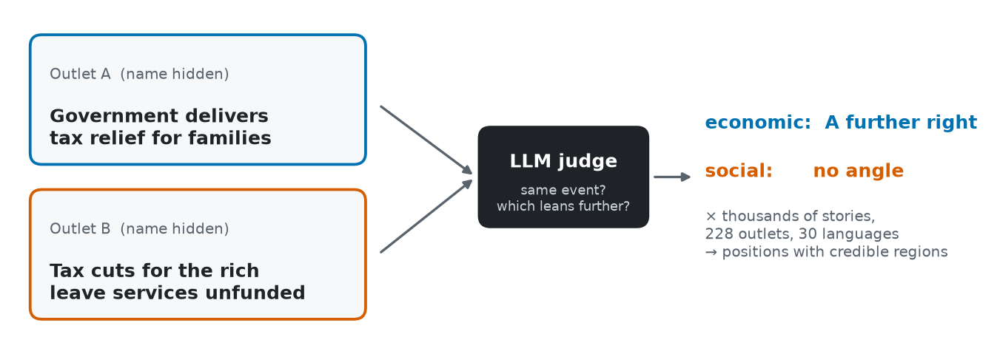

An LLM compares **two articles about the same story**, with the outlets' names hidden, and says which one frames it
further economically left or right, and further liberal or conservative. Thousands of those verdicts, across 228
outlets and 30 languages, go into a Bayesian model that places every outlet and country on a two-axis map — relative to
each other, never on an absolute scale — each with a **credible region**: the area where the model puts the outlet
with a given probability (50 % below). The same model decides which comparison is worth paying for next.

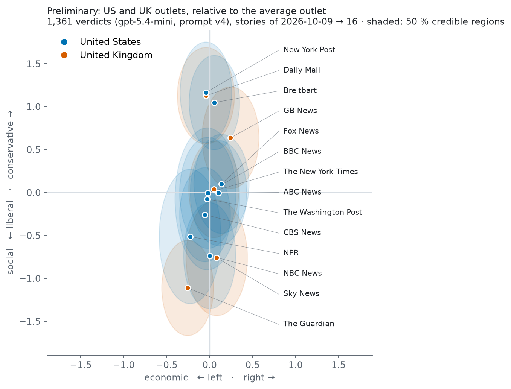

*Preliminary, one week of stories, US and UK only: the full picture needs the 2015 → 2026 history and daily live
judging (below).*

| Stage | State (2026-10-18) |
|---|---|
| 1 · Collect | 🟩 live on AWS since 2026-10-13: ≈ 13,000 articles a day, 41 countries |
| 2 · Same story | 🟩 live: daily, 30 languages, bounded in memory at full volume |
| 3 · Measure | 🟩 method complete and validated on one snapshot; live judging built, off until the history prior |
| 4 · Serve | 🟧 prototype site; the plane above is preliminary |
| 5 · Operate | 🟩 self-healing jobs, ≈ $0.78 a month of compute, data deleted once no step can use it |
| 6 · History | 🟨 6.7 M articles fetched; the local judge is being trained and tested |

## How it works

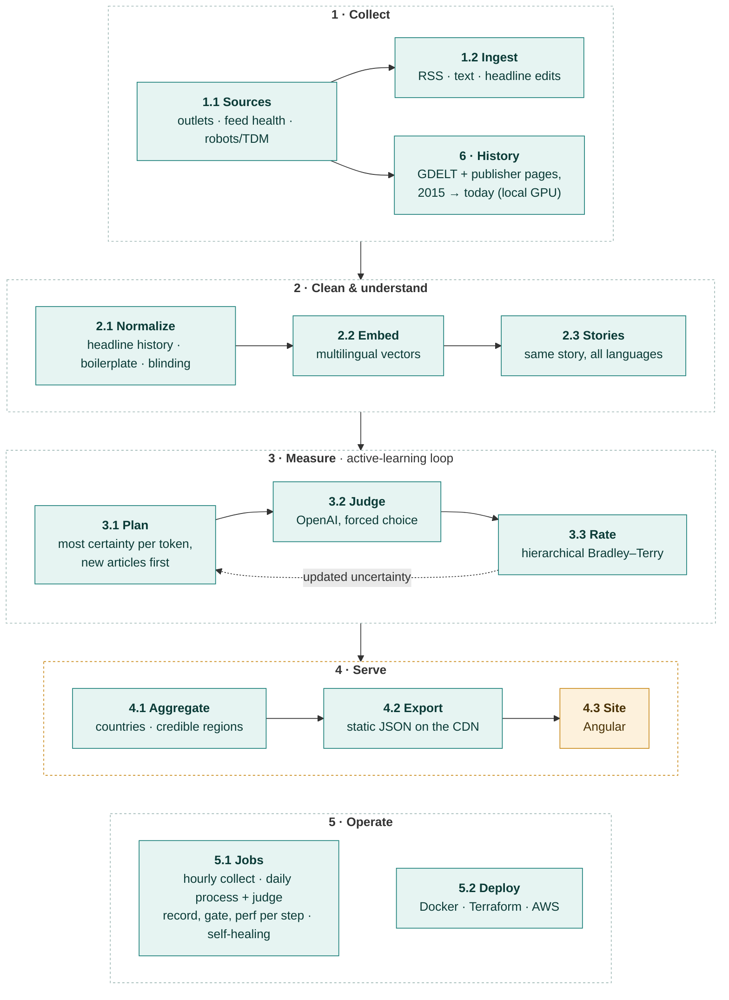

🟩 runs on real data · 🟧 prototype

Every step has one job, a typed contract, persisted output and **its own check** that runs in isolation. That way a
problem can be traced to the step that causes it. Each stage below has a short summary; open **Details** for the
steps. Step numbers match the diagram. `M1`…`M9` are the module IDs used in the code, ASSUMPTIONS.md and BACKLOG.md
(module index: [pipeline/README.md](pipeline/README.md)).

## 1 · Collect — 228 outlets, 41 countries, 30 languages
In each country the five largest online news brands in the Reuters Institute *Digital News Report* define where that
country stands; other outlets are extras (ADR-006). Every outlet is read hourly from its feeds. Publishers that opt out
of text and data mining, or block bots, are respected: they are judged on headline and summary only (ADR-007).

| | |
|---|---|
| outlets / countries / languages | 228 / 41 / 30 (205 in the reference set) |
| articles a day (measured 2026-10-18) | ≈ 13,000 |
| cost of an hourly run on day 300 vs day 3 | the same: only the URLs in the current feeds are looked up (A63) |

<details>
<summary><b>Details: 1.1 Sources · 1.2 Ingest</b></summary>

### 1.1 Sources · `M1` · `pipeline/sources/`
- **Does:** keeps the outlet registry and checks each outlet: feeds alive, freshness, robots.txt and the W3C TDM
  opt-out.
- **In → out:** `data/outlets.json` (228 outlets, 41 countries, 30 languages) → `feed_health`.
- **Reference set:** in each country, the five largest online news brands in the Reuters Institute *Digital News
  Report 2026* define that country's position (A29; 205 outlets). Other outlets are extras. 195 outlets have a working
  feed; the rest are read from their front pages next (BACKLOG).
- **Policy:** publishers that opt out or block bots are read as headline + summary only (A10, A33). We never spoof a
  browser or solve a challenge.
- **Check:** `uv run python -m pipeline.sources.run && uv run python -m pipeline.sources.eval`

### 1.2 Ingest · `M2` · `pipeline/ingest/`
- **Does:**
  - reads RSS (and RSS 1.0) and skips known URLs before downloading — it looks up only the URLs in the current feeds,
    so a run costs the same on day 300 as on day 3 (A63);
  - extracts text (JSON-LD → trafilatura → summary, A19);
  - strips HTML, site notices and paywall pages (A38);
  - records a new headline when a known URL's headline changes (A34);
  - dates undated items by when they were first seen (A39).
- **In → out:** feeds → `articles`, `headlines`.
- **Check:** `uv run python -m pipeline.ingest.report` → the chart and tables below. `--samples 1` prints text
  snippets; `--readme` refreshes the table.

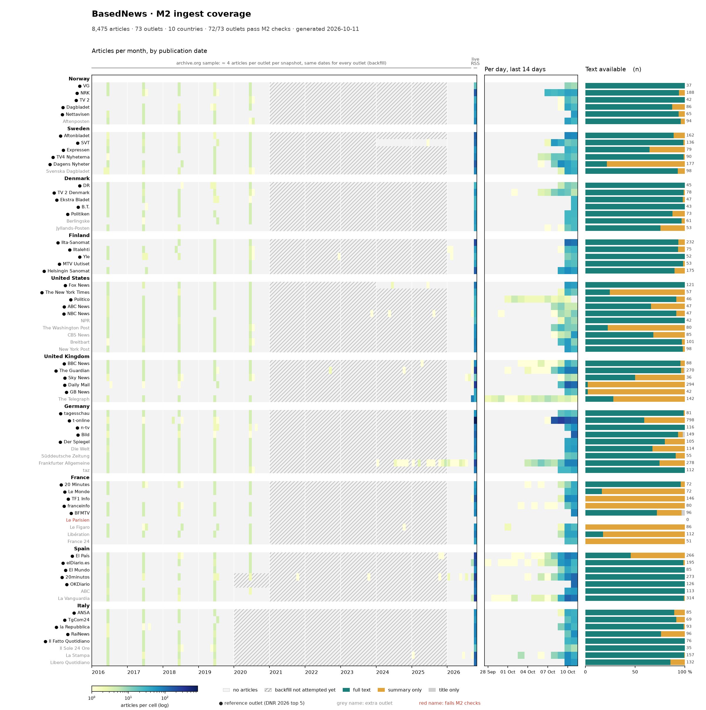

*The chart and the table below are the 10-country snapshot of 2026-10-11 (their history column is the archive.org
sample that 1.3 has since replaced).* Left: articles per month; right: what the judge can read — orange is policy, not
a bug. Per-outlet detail: [`reports/m2_ingest.md`](reports/m2_ingest.md). On 2026-10-16 the live database held 66,727
articles from 41 countries, 190 of 228 outlets passing the M2 checks.

<!-- m2:begin -->
*Snapshot 2026-10-11, regenerated by `uv run python -m pipeline.ingest.report --readme`.*

| Country | Outlets (ref / all) | Articles | Last 72 h | Last 14 d | History years (of 10, mean) | Full text | Summary only | Dated | Pass |
|---|---:|---:|---:|---:|---:|---:|---:|---:|---:|
| Norway | 5 / 6 | 512 | 366 | 413 | 4.0 | 94 % | 6 % | 100 % | 6/6 |
| Sweden | 5 / 6 | 742 | 570 | 644 | 4.8 | 74 % | 26 % | 100 % | 6/6 |
| Denmark | 5 / 7 | 400 | 279 | 295 | 4.3 | 94 % | 6 % | 100 % | 7/7 |
| Finland | 5 / 5 | 587 | 508 | 508 | 4.0 | 93 % | 7 % | 100 % | 5/5 |
| United States | 5 / 10 | 724 | 510 | 537 | 5.3 | 78 % | 22 % | 100 % | 10/10 |
| United Kingdom | 5 / 6 | 872 | 639 | 701 | 4.5 | 47 % | 53 % | 100 % | 6/6 |
| Germany | 5 / 9 | 1,808 | 1,409 | 1,612 | 5.2 | 74 % | 26 % | 100 % | 9/9 |
| France | 5 / 9 | 715 | 590 | 598 | 3.3 | 24 % | 76 % | 100 % | 8/9 |
| Spain | 5 / 7 | 1,372 | 1,176 | 1,244 | 4.9 | 89 % | 11 % | 100 % | 7/7 |
| Italy | 5 / 8 | 743 | 611 | 627 | 4.0 | 92 % | 8 % | 100 % | 8/8 |
| **All** | 50 / 73 | **8,475** | 6,658 | 7,179 | 4.5 | 75 % | 25 % | 100 % | 72/73 |
<!-- m2:end -->

</details>

---

## 2 · Find the same story in 30 languages
Articles are embedded in one multilingual space and grouped into stories over a rolling 7-day window; a story covered
by two outlets gives a pair to compare. Choosing the embedding model taught the project's first method lesson — **a
test set chosen by one model decides the comparison** (F2):

| test | the model that chose the test pairs | result |
|---|---|---|
| E7: pairs sampled with the local MiniLM | MiniLM | MiniLM looked twice as good (recall 0.83 vs 0.42) |
| E7b: random anchors, both models' candidates pooled, labelled blind | neither | OpenAI ahead on every measure (AUC 0.965 vs 0.925) |
| E7, E7b: 512 vs all 1,536 dimensions | — | equal (AUC 0.963 vs 0.964), a third of the storage |

At full volume (≈ 170,000 articles in a window) the clustering ran out of memory; it was rewritten to work from close
pairs and running sums — **the same partitions, memory that grows with the close pairs instead of n²** (ADR-004).

<details>
<summary><b>Details: 2.1 Normalize · 2.2 Embed · 2.3 Stories</b></summary>

### 2.1 Normalize · `M3` · `pipeline/normalize/`
- **Does:**
  - **Renames and containers:** when one stored text appears under several headlines, decides by content whether it
    is one article that was renamed (any number of times → one article with a headline history) or a live-blog or
    news-list page. On a page, only the entry that matches it keeps the text (A34).
  - **Boilerplate:** removes paragraphs that repeat across an outlet's articles at the start or end, across different
    stories: footers, pop-ups, tip boxes, copyright lines. Repeats in the body text are kept (A40).
  - **Non-articles:** marks items that are not one article (multi-topic show pages, site pages, headline-only items)
    and drops consent walls (A38).
  - **Bounded:** reads the last 14 days (plus older copies of their texts), one outlet at a time, since every rule
    compares an outlet only with itself (A63).
  - **Blinding and genre:** removes the outlet's own name from titles (A42) and tags opinion pieces (A43).
  - **Article content is never shortened or rewritten**; only non-content is removed (A41).
- **In → out:** `articles` → `articles.canonical_id`, `kind`, `genre`, `headlines`. Removed texts are backed up, so
  every step can be reversed.
- **Check:** `uv run python -m pipeline.normalize.run`, then
  `uv run python -m pipeline.normalize.eval --samples 3` → `reports/m3_normalize.png`. The vectors it compares are
  cached by text, so a daily run only pays for new headlines (A56).

### 2.2 Embed · `M4` · `pipeline/embed/`
- **Does:** one multilingual vector per article. An article with several headlines gets the mean over its
  versions (A35).
- **Model:** OpenAI `text-embedding-3-small`, shortened to 512 dimensions (A56, ADR-011). It was chosen by E7b, a
  blind pooled test on our own stories where neither candidate picked the test pairs; 512 measured equal to the full
  1,536 at a third of the storage (E7). The local multilingual MiniLM stays as the baseline (`uv sync --group ml`).
- **Thresholds belong to the model:** each model has a calibrated profile, and a model without one refuses to run
  2.1 and 2.3 (A47, `pipeline.embed.calibrate`).
- **Cost:** ≈ $0.07–0.12 a day at 41 countries, inside the monthly AI cap, which the encoder enforces (A48).
- **Bounded:** reads its 14-day window in chunks of 900 articles (A63).
- **In → out:** canonical `articles` + `headlines` → `embeddings` (re-embedded when a new headline arrives).
- **Check:** `uv run python -m pipeline.embed.eval`: are an article's nearest neighbours the same story in other
  languages?

### 2.3 Stories · `M5` · `pipeline/events/`
- **Does:** time-aware average-linkage clustering over a rolling 7-day window (72 h window, 96 h decay, threshold
  0.56 from the model's profile; A20, ADR-004). Re-run daily: a later article joins its story and adds new pairs.
- **At scale:** computed exactly from the close pairs and running sums of distances, never the full distance matrix,
  so a full 41-country window (≈ 170 k articles) fits in ≈ 1.6 GB; identical partitions to the full method on real
  windows of 41,677 and 60,778 articles (ADR-004). A story with articles from two outlets gives a comparable pair (A02). Two outlets publishing the same
  headline and the same text is a known tie: it is kept but never sent to the judge (A44).
- **In → out:** `embeddings` → `event_members`, `same_text_pairs`.
- **Check:** `uv run python -m pipeline.events.eval` (precision and recall per threshold on the labelled pairs in
  `data/eval/`). The fair comparison of embedding models is E7b's pooled test
  (`uv run python -m pipeline.experiments.e7b analyse`).

</details>

---

## 3 · Measure — a judge, a model, and a planner
**The judge (3.2).** Four prompt versions, each changed because of a measured failure, never toward an expected answer:

| version | what was found | change |
|---|---|---|
| v1 "which is further right?" | picked the article with more material 71 % / 86 % of the time; the mirrored question agreed only 20 % on social | scores on a symmetric scale, "length is not evidence" |
| v2 scores −2…+2 | length lean gone, but decisive on only 22 % / 30 % of pairs | one forced choice per axis, no reasons, the question's direction random per call (decisive 38 % / 63 %) |
| v3 forced choice | on real stories (E4), "trusts police and authorities" in the conservative definition made straight news quoting officials read conservative | axis definitions rewritten; quoting officials, length, tone, language and order named as *not* a leaning |
| **v4** | | **locked** (E10) |

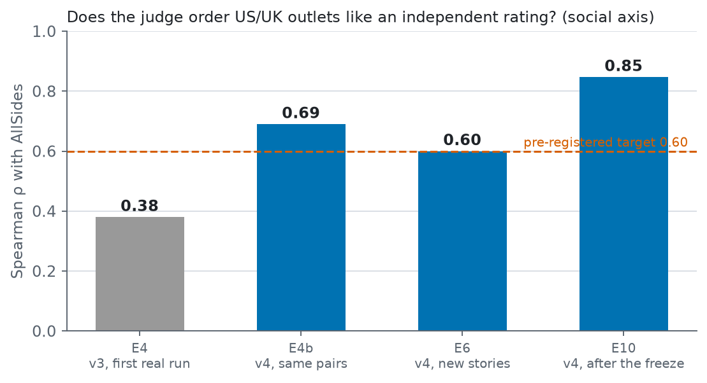

**The model (3.3).** A Bayesian Bradley–Terry model with the judge's order bias as a parameter (ADR-001, ADR-003). One
article compared many times is not independent evidence (**F1**): 81–87 % of the variation in judged framing is
article-to-article within an outlet, so outlets are measured over their articles (hierarchical, spreads estimated from
the data; ADR-009). From 300 judged articles it runs on sparse algebra with identical numbers — 60,000 articles in about
a second, where the dense fit would need 29 GB per step (A66).

**The planner (3.1).** Each call buys the comparison that removes the most uncertainty per token (active learning,
ADR-002). Most calls cannot answer the economic question (a crime story, a football result), so a logistic model on the
pair's vector predicts which can before paying (**F3**, AUC 0.90 on live verdicts, A70). And no outlet is ever "done":
each gets at least five comparisons a week, however well it is known (A69).

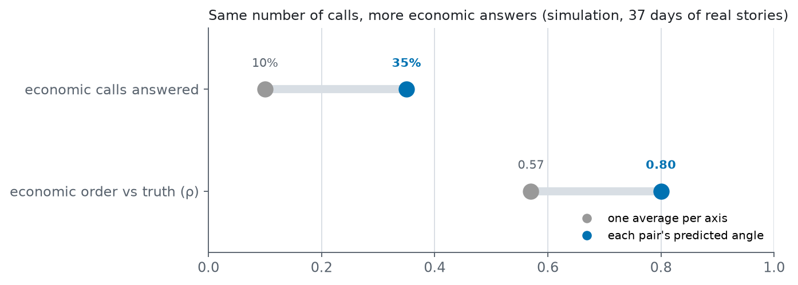

<details>
<summary><b>Details: 3.1 Plan · 3.2 Judge · 3.3 Rate · the loop</b></summary>

### 3.1 Plan · `M6` · `pipeline/plan/`
- **Does:** scores every available story pair by the expected reduction in outlet and country variance **per
  token**, on both axes jointly (A31, A32, ADR-002). It works per article: a new article enters with the full
  article spread, while one already judged is mostly pinned down, so repeated looks at the same article have
  diminishing returns (A49, ADR-009).
- **Pairs:** like with like only (full text with full text, news with news, opinion with opinion; A21, A43). Known
  ties and pairs already judged with the current prompt are skipped. Article order is random (A04).
- **In → out:** stories + current posterior + budget → comparison requests.
- **Check:** `uv run python -m pytest -q tests/test_hierarchical.py` (diminishing returns). Simulator:
  `uv run python -m pipeline.sim.eval_loop`.

### 3.2 Judge · `M7` · `pipeline/judge/`
- **Does:** one call per article pair answers both axes as a forced choice, with no reasons (prompt v4, A46).
  - **Questions:** "Which article's framing is more economically LEFT: A or B?" and "Which article's framing is more
    LIBERAL: A or B?". On a random half of calls the questions are worded RIGHT and CONSERVATIVE instead.
  - **"na"** only when the story has no angle on that axis (A32).
  - **Axis definitions** are in the system prompt: what each side centres, and what it treats as the problem and as
    the solution. The prompt also says what is *not* a leaning: quoting officials, length, tone, language, order.
    Full text in [`pipeline/judge/prompt.py`](pipeline/judge/prompt.py).
- **Input:** the whole article, never shortened (A41); the latest headline plus earlier versions (A36); the outlet's
  own name masked (A42).
- **Model and logging:** `gpt-5.4-mini` with low reasoning effort (A11, A45) live; for the history Qwen3-14B on a
  local GPU with a LoRA adapter trained on gpt-5.4-mini's verdicts, if it passes E9's test (E11, A65). Every call, verdict, token and cent is
  stored with the prompt version (`judge_calls`, `judgments`, `api_usage`; A48).
- **Full archive of every paid call (A51):** the exact request with the rendered articles, the provider's full
  response (model snapshot, fingerprint, token breakdown), timing, retries and failures, and what the planner knew
  when it picked the pair. Later analyses never have to buy a call again. Check: `uv run python -m pipeline.judge.calllog`.
- **Check:** `uv run python -m pipeline.judge.eval --pairs 60` → `reports/m7_judge_eval_v4.md`. It measures:
  - order swap, test–retest and the mirrored question (A28);
  - first-shown and length lean;
  - identical pairs;
  - cost per call.

  Run it after any prompt or model change; `--prompt v3` compares with an older version.

### 3.3 Rate · `M8` · `pipeline/rate/`
- **Does:** hierarchical Bayesian Bradley–Terry. Each article sits around its outlet (θ_article = θ_outlet + ε). The
  model includes a judge order-bias term β and a per-comparison sharpness (full text vs summary).
  - **Spreads:** the outlet spread τ and article spread σ_a are estimated from the data (Laplace evidence) and
    averaged over a grid, not set by hand (A49, ADR-009).
  - **Output:** a Laplace posterior gives every outlet a position and an sd per axis (A05, ADR-001, ADR-003).
  - **At scale:** past 300 judged articles the same fit runs on sparse algebra, with the same numbers (A66): ≈ 60 k
    articles fit in about a second.
- **In → out:** `judgments` → `positions` (mean, sd, number of comparisons per outlet and axis) + covariance.
- **Check:** `uv run python -m pytest -q` (recovery tests). Coverage under article reuse:
  `uv run python -m pipeline.sim.eval_articles` (E5).

### The loop · `pipeline/measure/`
- `pipeline.measure.run`:
  1. plans a batch;
  2. judges it in parallel;
  3. refits;
  4. repeats.

  It stops at `--budget-usd`, `--max-calls` or the monthly cap (`BASEDNEWS_MONTHLY_AI_USD`, default $12; A48). The
  final fit is written to `positions`. `--dry-run` prints the first prompt and the cost estimate;
  `--countries "United States,United Kingdom"` restricts the pool; `--settle-hours N` holds back articles younger
  than N hours (default 0: pairs are judged as they appear, A58).
- In production the `judge` job runs it daily with a daily budget ($0.15 by default), followed by the export. It is
  switched off until the history gives live judging its starting point.

</details>

---

## 4 · Serve — the map
Everything is relative: (0, 0) is the average reference outlet, and a country is the reach-weighted mean of its
reference outlets (ADR-005, A08). Each position carries its credible region from the model's full covariance. The site
is static files on a CDN — no API server (ADR-010). Today it shows a labelled demo and the preliminary fit; real
positions go public by the maintainer's decision (A54).

<details>
<summary><b>Details: 4.1 Aggregate · 4.2 Export · 4.3 Site · what a reader will get</b></summary>

### 4.1 Aggregate · `M9` · `pipeline/aggregate/`
- **Does:** everything is relative. (0, 0) is the average reference outlet (A26, ADR-005). A country is the
  reach-weighted mean of its reference outlets (A08). Each position carries a credible region (±k sd per axis, A25; its size is chosen once the full
  history and live judging exist). Country sds use the full posterior covariance.
- **In → out:** a posterior → plane points (outlets, countries, credible regions).
- **Check:** `uv run python -m pipeline.aggregate.preview` (credible-region coverage close to 1 − e^(−k²/2)).

### 4.2 Export · `pipeline/export/`
- **Does:** refits the article-level model from every real verdict of the current prompt and writes
  `plane-latest.json` (countries and outlets with credible regions) for the site. Only aggregates: no text, titles or URLs (A10).
- **Out:** `frontend/src/data/` locally (git-ignored, served by `ng serve` at `/data/`); in production the job uploads
  it next to the site, only if the maintainer turns publishing on (A54).
- **Check:** `uv run python -m pipeline.export.run --check`: valid JSON, finite numbers, every country present, gzip
  size under 100 kB (today about 3 kB). Trends join this file once the trend model exists.

### 4.3 Site · `frontend/` (Angular)
- **Does:** world plane → click a country → its outlets; play the measurement over time. Run with
  `bash scripts/start.sh` (site :4200).
- **Today the plane shows:**
  - a simulated demo (real outlets and story pairs, random positions; active vs random selection);
  - a replay of E4, the first real run, which used prompt v3 and the flat model, both since replaced;
  - the latest fit (4.2) when its file is present, as "Latest fit".

  All are labelled on the page.
- **Data:** static JSON: the demo and the E4 replay from `frontend/src/assets` (rounded to 3 decimals, under 70 kB
  compressed each), the latest fit from `data/` (4.2).
- **Never serves article text** (A10).

### What a reader will get
- **World view:** each country's national media as a dot with its credible region. Click a country →
- **Country view:** its major outlets, each with its credible region.
- **Story lens & blindspots:** how the same international story is framed across countries and outlets.
- **Historical change graphs (must, not built yet):** each outlet's and country's position over the last 10 years,
  with its uncertainty band, backed by the archive sample.
- **Methodology in the open:** prompts, maths, assumptions, evaluation results.

</details>

---

## 5 · Operate — live on AWS for about a dollar a month
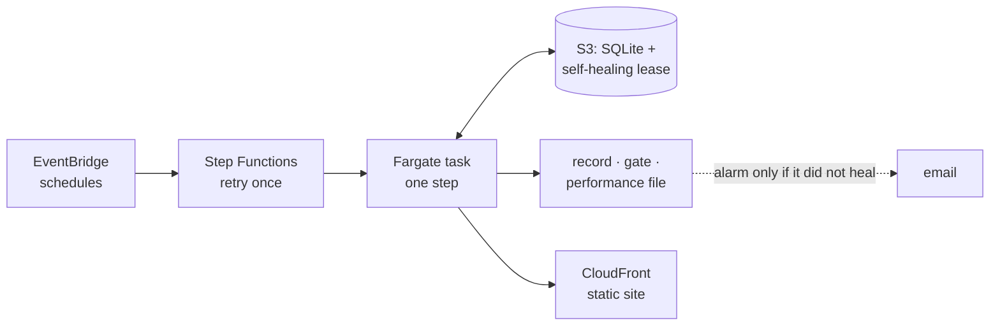

Scheduled container jobs, the database in S3 behind a lease that heals itself when a task dies (ADR-012), a record, a
quality gate and a performance file for every step, and a cost kill switch. Every fix was sized for steady-state
volume before it was made, never by raising memory (A63). Data is deleted once no step can read it again; verdicts and
positions are archived for good (A52). How it fits together and the incidents it survived:
[docs/ARCHITECTURE.md](docs/ARCHITECTURE.md).

| measured by the jobs themselves (2026-10-18) | |
|---|---|
| compute | ≈ $0.78 a month |
| peak memory | ≤ 18 % of the 4 GB limit, on every step |
| database at steady state | ≈ 1.5 GB (14 days of text and vectors) |
| OpenAI (embeddings) | ≈ $2.50 a month |

<details>
<summary><b>Details: 5.1 Jobs · 5.2 Deploy · costs</b></summary>

### 5.1 Jobs · `pipeline/job/`
- **Does:** `python -m pipeline.job <step|job>` runs a module's own `main()`, then its **gate**: a few numbers from
  the module's eval, each against one threshold (A53). It stops at the first step that fails, and every step leaves a
  **record**: commit, arguments, table counts before and after, the gate's numbers, the error and traceback (in
  `job_runs`, and as JSON). Logs are JSON lines. A paid step refuses to run without an explicit budget (A48).

  | Job | Steps | Schedule (UTC) | State |
  |---|---|---|---|
  | refresh | ingest | hourly | on |
  | process | normalize → embed → stories | daily 02:35 (A63) | on |
  | feeds | sources | daily | on |
  | judge | measure → export | daily, with a daily budget (A58) | off until the history prior |
  | maintenance | retention | daily | on with the next `terraform apply`: deletes what no step can read again (D7) |

- **State:** in production the SQLite file lives in S3. A step takes a lease, downloads it, runs, and uploads it only
  if the step and its gate passed, the lease is still its own, and the stored file is still the version it downloaded
  (A55). A failed step leaves the stored database as it was, so the site keeps its last good data.
- **Self-healing (ADR-012, A62):** the lease is renewed every minute and taken over when silent for 5 min; a stopped
  task ends cleanly; the state machine retries a crashed step once; alarms fire only when it did not heal.
- **Performance (A64):** every step attempt writes its phases, CPU, peak memory against the limit and its cost —
  every minute while it runs. `uv run python -m pipeline.job perf --days 1` prints the report and a monthly projection.
- **Retention (A52):** data is kept exactly as long as a step can still read it. Text, vectors and normalize's undo
  copies go after 14 days (normalize's and embed's lookback; stories read 7), story runs except the newest two, the
  retired scraper's rows; verdicts, positions, records, article metadata and the full judge requests are first written
  to monthly Parquet files and read back. Steady state ≈ 1.5 GB (`pipeline/retention/`, `--apply` in the job).
- **Check:** `uv run python -m pytest -q tests/test_job.py tests/test_storage.py tests/test_retention.py`;
  `uv run python -m pipeline.job history`.

### 5.2 Deploy · `infra/`, `Dockerfile`, `.github/workflows/ci.yml`
- **Does:** one Docker image (arm64) for every step; Terraform for every AWS resource: S3 + CloudFront for the site,
  ECS Fargate tasks started by Step Functions on EventBridge schedules (created off), alarms by email, and a kill
  switch that turns the schedules off if the month's AWS cost passes $15. GitHub Actions runs lint, tests, Terraform
  checks and a smoke test inside the built image on each push and, on main, ships the image and the site through
  narrow OIDC roles; it never changes infrastructure (A57).
- **Check:** `terraform -chdir=infra/main validate`; `uvx checkov -d infra --config-file infra/.checkov.yaml` (every
  skipped check has its reason); `docker compose run --rm job list`.

### Costs (per month)
AWS measured by the performance report (A64) on 2026-10-17, with the 7-day window still filling; OpenAI from the
spend log (`api_usage`):

| | AWS | OpenAI |
|---|---|---|
| refresh (hourly collect) | ≈ $0.45 (≈ 1 min an hour) | — |
| process (daily) | ≈ $0.15 (≈ 10 min a day) | ≈ $2.50 (embeddings: $0.07–0.12 a day at 41 countries) |
| feeds | ≈ $0.01 | — |
| judge (daily, off) | ≈ $0.10 when on | ≤ $4.50 ($0.15 a day) when on |
| storage, CDN, alarms | ≈ $0.50 (estimate) | — |
| **Total today** | **≈ $1.10** | **≈ $2.50** |

Processing grows with the window; the report projects it every day.

Caps: the app refuses AI calls past $12 a month (A48), OpenAI's own reload limit is $10 a month, and the AWS kill
switch fires at $15.

</details>

---

## 6 · History — eleven years on a gaming GPU
The product's must is change over time: every outlet since 2015-11. GDELT lists the URLs; each publisher's own page
gives headline and description.

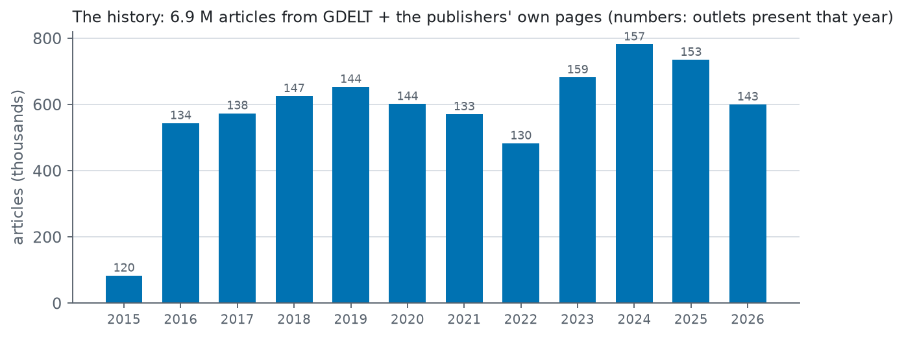

**The cost problem.** Every same-story pair over eleven years is ≈ 12 M judge calls. With gpt-5.4-mini that is
≈ $18,600; the planner's 5 % is ≈ $930. The plan: the same calls on a local GPU, with an open model taught to judge like
the paid one.

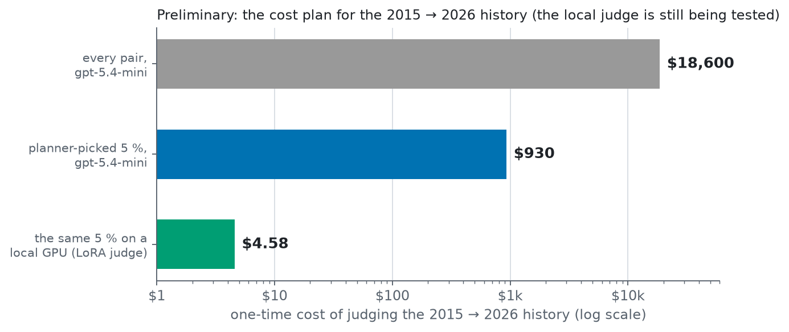

**A local judge.** Four experiments so far:
1. **Off-the-shelf models fail (E9, F4).** Qwen3-14B and -8B, with and without reasoning, abstain on the social axis
   where gpt-5.4-mini takes a side; reasoning first costs 50× the tokens and changes almost nothing.
2. **Lock the prompt before teaching it (E10).** Training freezes the prompt, so v4 was re-checked on stories collected
   after it was frozen ($1.00).
3. **Teach it (E11).** A LoRA adapter on Qwen3-14B, trained on 3,085 gpt-5.4-mini verdicts on history pairs
   ($3.58), sampled in batches of whole days that never overlap, with held-out validation days. On E9's 943 unseen
   test calls it doubles social κ (0.20 → 0.40), still short of the paid judge's agreement with itself.
4. **Is the rest data or decision rule? (learning curve, E12).** Trained on ⅓, ⅔ and all of the days, most of the
   gain comes with the first third. Read from its probabilities with a cut for "no angle", it does no better: its
   misses are not hidden decisions. Results: [e11_results](docs/experiments/e11_results.md).

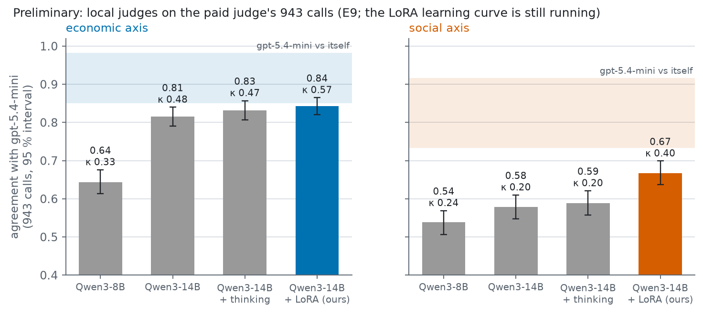

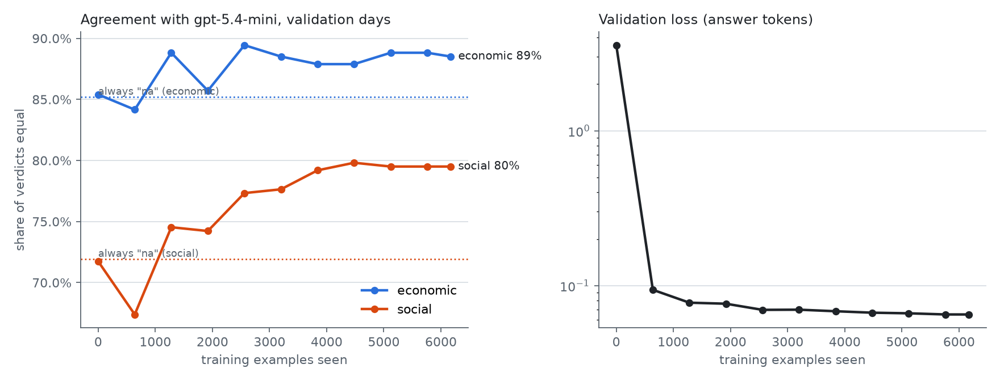

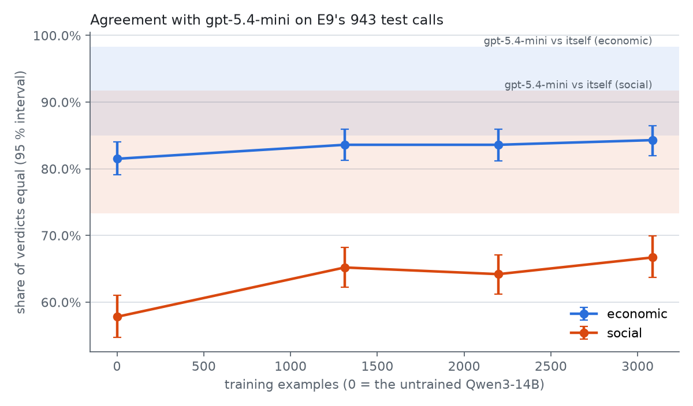

**What the local judge has to deliver** is not call-by-call parity with a paid model, but outlets that separate on the
plane, in the right order. **Positions over time** come from a weekly random walk per outlet whose drift is chosen by
the evidence (A67): a run of odd articles cannot undo years of verdicts, and uncertainty regrows when an outlet goes
unmeasured. *A side lesson:* the first speed test copied the paid model's call shape and measured 10,000 calls an
hour; the real call answers in 14 tokens with a cached prompt: 51,000. Measure the call the system will actually make.

<details>
<summary><b>Details: how the history is built and judged</b></summary>

### 6.1 How the history is built · `pipeline/history/` (A61)
- **Does:** the history from 2015-11-01, for the five reference outlets of every country (205 outlets), at daily
  resolution:
  1. **Candidates** (`gdelt.py`): GDELT's GKG on BigQuery (the free sandbox) lists each outlet's URLs per day; a cheap
     pre-filter keeps up to 20 per outlet and day that mention entities other outlets mention too.
  2. **Pages** (`fetch.py`, `prefetch.py`): each publisher's own page gives headline, description and publish time —
     headline + snippet only, never the full text (A10); one request at a time per site, ≥ 1 s apart, robots.txt
     respected; a month at a time, resumable.
  3. **Replay** (`replay.py`): a 7-day window moves day by day through the timeline with the live modules — embed,
     stories, plan, judge — so every day is measured the way live measures today.
- **Local, not paid:** judging eleven years with gpt-5.4-mini would cost ≈ $18,600 for every pair, ≈ $930 for a
  planner-picked 5 %. The judge and the embeddings run on the maintainer's gaming PC (RTX 5080, ≈ 51,000 judge calls
  an hour) behind an OpenAI-compatible server ([docs/LOCAL_LLM.md](docs/LOCAL_LLM.md), A65), tested against live's
  models first: E8 (embeddings), E9 (off-the-shelf judges: not valid on the social axis), E11 (a LoRA-trained judge).
- **Pilot first:** 2019, every article embedded and grouped (free); the judge spends 5 % of all pairs, each counted
  once, picked by the live planner (A68) with each pair's own chance of an answer (A70), and every outlet compared at
  least five times a week (A69). Its per-outlet uncertainty says how much more the full run needs.
- **Trajectories** (`trajectories.py`, A67): each outlet's position on a weekly random walk, relative to the week's
  average reference outlet, with its uncertainty. Step by step: [docs/HISTORY.md](docs/HISTORY.md).
- **Superseded:** the archive.org sample (`pipeline/backfill/`, ADR-008) — rate limits made eleven years of it
  impractical.

</details>

---

## Experiments on real data
E4, E6, E7, E7b and E8–E12 were pre-registered (criteria fixed and hashed before the run). Every experiment is recorded whatever the
outcome. They are **exploratory, not claims**. What they changed:

| ID | Question | What it changed | Record |
|---|---|---|---|
| E1–E3 | Does cost-aware selection save tokens? (simulation; E3 replays real stories with simulated verdicts) | planner design | [METHOD.md](docs/METHOD.md) |
| E4 | First real measurement, $2, 10 countries: does the judge reproduce known orderings (AllSides ratings, within-country contrasts)? | social-axis definition rewritten → prompt v4 | [e4_results](docs/experiments/e4_results.md) |
| E4b | The same US/UK pairs re-judged with prompt v4 | v4 adopted | [e4b_results](docs/experiments/e4b_results.md) |
| E4c | Why did single outlets disagree? Respecting noise, no prompt tuning toward expected answers | found article reuse → F1, hierarchical model | [e4c_diagnosis](docs/experiments/e4c_diagnosis.md) |
| E5 | Simulation: does reusing articles break the flat model's intervals? | hierarchical model adopted (ADR-009) | [e5_article_effects](reports/e5_article_effects.md) |
| E6 | Fresh stories with v4, the hierarchical model and the article-aware planner | to be repeated out of sample on next week's stories | [e6_results](docs/experiments/e6_results.md) |
| E7 | OpenAI embeddings for story matching: 512 vs 1536 dimensions | 512 is enough; its MiniLM comparison was invalid (test set chosen by MiniLM) and withdrawn | [e7_results](docs/experiments/e7_results.md) |
| E7b | The unbiased re-test: random anchors, both models' top candidates pooled, labelled blind | OpenAI @512 adopted for embeddings, story threshold 0.56 | [e7b_results](docs/experiments/e7b_results.md) |
| E8 | Local embeddings for the history: three open models vs live's OpenAI @512, pooled and blind like E7b | in progress | [e8_prereg](docs/experiments/e8_prereg.json) |
| E9 | A local judge for the history: does an open-weights model answer like gpt-5.4-mini, as often as gpt-5.4-mini agrees with itself? | none valid on the social axis (they abstain where it decides) → F4, E11 | [e9 report](reports/e9.md) |
| E10 | Prompt v4 out of sample on fresh US/UK stories, before training locks it ($1.00) | target met (AllSides ρ 0.85, 12 outlets) → v4 locked | [e10 report](reports/e10.md) |
| E11 | A local judge trained on 3,085 gpt-5.4-mini verdicts (LoRA, $3.58), tested with E9's harness; learning curve on ⅓, ⅔, all of the data | social κ 0.20 → 0.40; not valid by E9's rule; flat after ⅓ → F5 | [e11_results](docs/experiments/e11_results.md) |
| E12 | The LoRA judge read from its probabilities: does a cut for "no angle", tuned on validation days, recover its misses? | no: misses become inventions and flips → F5 | [e11_results](docs/experiments/e11_results.md) |

A50 states what is measured: framing of the **same event**, not which stories an outlet chooses to cover. External
ratings include both, so agreement with them has a ceiling below 1. Disagreement is something to explain, not a
target to tune toward.

## What the project taught about method
**F1 — measure outlets over their articles.** One article compared many times is not independent evidence. On real
verdicts, 81–87 % of the variation in judged framing is article-to-article within an outlet (ICC 0.13–0.19). A flat
model overstates certainty and lets single articles decide an outlet's position. A hierarchical model with article
effects fixes this, and active selection now prefers new articles.

**F2 — a test set chosen by one model decides the comparison.** Labelled pairs sampled with MiniLM made MiniLM look
twice as good as OpenAI's embeddings (E7); on a blind pooled test that neither model chose, OpenAI was ahead on every
measure (E7b). 512 dimensions matched the full 1,536 on both tests.

**F3 — most calls cannot answer the economic question, and a story's vector says in advance which can.** The judge
finds an economic angle in 14 % of pairs; a logistic model on the pair's vector predicts it with AUC 0.90 out of fold,
and at the same budget it raised the share of answered economic calls from 10 % to 35 % in simulation.

**F4 — off-the-shelf local judges are cautious where the paid judge decides.** On the social axis they say "no angle"
in 81–86 % of pairs where gpt-5.4-mini takes a side in about half; reasoning first costs 50× the tokens and changes
almost nothing. The gap is a decision boundary to teach, not a lack of size.

**F5 — $3.58 of the paid judge's verdicts doubles a local model's social κ, and then it flattens.** The first third of
the data gives most of the gain; validation loss keeps falling after agreement stops moving. Its remaining misses are
not near-decisions, and agreement with the teacher is the wrong yardstick for where to draw the line: with cheap
local calls, the judge to keep is the one whose verdicts separate outlets best.

**And six habits that came out of it.** Pre-register, then look. Pool and blind any test where a candidate could have
chosen the data. Measure outlets over their articles. Count what a call can tell, not just what it costs. Use the paid
judge's agreement with itself as the ceiling for any replacement. Size every fix for steady state, and measure the
workload the system will really run.

Evidence, limits and how to reproduce: [docs/FINDINGS.md](docs/FINDINGS.md).

## Decisions: industry standard vs what was explored
Eighteen design choices where the project tried something other than the usual default, each with a record.

<details>
<summary><b>Details: decision table</b></summary>

| Step | Choice | Standard / baseline | Explored here | Record |
|---|---|---|---|---|
| 3.3 | Ranking | Elo | Bayesian Bradley–Terry + judge bias + per-comparison sharpness | [ADR-001](docs/decisions/ADR-001-ranking-model.md) |
| 3.3 | Unit of evidence | each comparison independent | outlets measured over their articles (hierarchical, spreads estimated) | [ADR-009](docs/decisions/ADR-009-article-effects.md) |
| 3.1 | Selection | random / info-gain | uncertainty reduction **per token**, per article | [ADR-002](docs/decisions/ADR-002-active-selection.md) |
| 3.2 | Judge answer | score on a scale, with reasons | forced choice per axis, no reasons, question wording randomised | A46 in [ASSUMPTIONS.md](ASSUMPTIONS.md) |
| 3.2 | LLM order bias | ask both orders (2×) | estimate β | [ADR-003](docs/decisions/ADR-003-judge-order-bias.md) |
| 2.3 | Clustering | threshold + components | average linkage, time-aware | [ADR-004](docs/decisions/ADR-004-event-clustering.md) |
| 2.2 | Embedding model | a benchmark score, or a test labelled from the current model | blind pooled test on our own stories; 512 of 1,536 dimensions; vectors cached by text | [ADR-011](docs/decisions/ADR-011-embeddings.md) |
| 4.1 | Scale | absolute labels | relative only | [ADR-005](docs/decisions/ADR-005-relative-scale.md) |
| 1.1 | Outlet set | hand-picked | Reuters DNR reach, two tiers | [ADR-006](docs/decisions/ADR-006-reference-set.md) |
| 1.1–1.2 | Scraping | take everything | robots.txt + TDM opt-outs + bot blocks respected | [ADR-007](docs/decisions/ADR-007-text-policy.md) |
| 1.3 | History | commercial archives | sparse synchronised Wayback sample | [ADR-008](docs/decisions/ADR-008-history.md) |
| 5 | Hosting | always-on API server + managed database | scheduled jobs with a gate per step, static site, small hot database in S3 with a bounded window, CI that cannot change infrastructure | [ADR-010](docs/decisions/ADR-010-deployment.md) |
| 5 | One writer, no operator | managed database, or DynamoDB locks | a lease in S3 with conditional writes, fencing, clean stops and retries; alarms on lack of success | [ADR-012](docs/decisions/ADR-012-self-healing.md) |
| 2.3 | Clustering at scale | the full distance matrix (n²) | exact average linkage from close pairs and running sums: memory grows with the close pairs | [ADR-004](docs/decisions/ADR-004-event-clustering.md) |
| 1.3, 3.2 | History judge | a paid API (≈ $930 at 5 %) | an open-weights model on a local GPU, LoRA-trained on $3.58 of the paid judge's verdicts, validated against it before use | A65, E9–E11 |
| 3.1 | Relevance per call | one average chance of an answer | each pair's own chance, learned from the judge's past answers | A70, F3 |
| 3.1 | Coverage | spend where uncertainty is highest | plus a weekly minimum per outlet, so no outlet is ever "done" | A69 |
| 5 | Retention | a fixed time window | delete exactly what no step can read again; archive verdicts for good | A52, D7 |

All working assumptions are in [ASSUMPTIONS.md](ASSUMPTIONS.md), each with what depends on it and how to test it.
Human sign-offs per stage are in [VERIFY.md](VERIFY.md).

</details>

## What's left
**Done** means: live judging runs daily from a starting point measured on the history, the site shows every outlet's
and country's trajectory since 2015 with its uncertainty, and this README states results. Tracked in
[BACKLOG.md](BACKLOG.md); the maintainer's decisions and sign-offs in [VERIFY.md](VERIFY.md).

| # | Step | State |
|---|---|---|
| 1 | Local judge trained on gpt-5.4-mini's verdicts (E11) → E9's test | done: not valid by E9's rule; D1 |
| 2 | Learning curve → another batch of training verdicts if it still rises | done: flat after ⅓; the rule asks for b2 (noise) |
| 3 | E8: the local embedding model for the history | next (the GPU) |
| 4 | Embed the 6.7 M history articles | ≈ 1 GPU hour |
| 5 | 2019 pilot: 5 % of pairs, weekly floor, per-pair angle | ≈ 1 GPU hour |
| 6 | Pilot trajectories on the hosted site → the maintainer's sanity check | after 5 |
| 7 | The full history, 2015 → 2026 | ≈ 12 GPU hours |
| 8 | Live judging from the history prior | the maintainer's go, ≤ $0.15 a day |
| 9 | Results in this README | after 7 and 8 |
| 10 | Credible-region size, positions public, then basednews.info | last, with the data |

## Possible claims (hypotheses, not results)
Seven things the project hopes to show. None is established.

<details>
<summary><b>Details: H1–H7 and how each will be tested</b></summary>

- **H1 · Cost:** choosing comparisons by uncertainty reduced *per token* reaches a target certainty with fewer LLM
  tokens than random pairing. *Test:* equal-budget runs with the real judge.
- **H2 · Model:** Bayesian Bradley–Terry ranks outlets at least as well as Elo and adds calibrated uncertainty.
  *Test:* rank agreement and interval coverage on held-out judgments.
- **H3 · Judge bias:** estimating the judge's order bias is as good as asking both orders, at half the calls.
  *Test:* order-swap eval (3.2).
- **H4 · Matching:** multilingual embeddings find the same story across countries well enough to compare framing.
  *Test:* precision and recall on labelled same-story pairs (2.3).
- **H5 · Summaries:** headline + summary carries enough signal to judge outlets that block full text.
  *Test:* judge agreement, summary vs full text (A30).
- **H6 · Prompt:** an evolved judge prompt gives more decisions that survive an order swap, per token, than a
  hand-written baseline, without deciding more often on pairs with no real difference. *Test:* held-out test set.
- **H7 · Validity:** on US/UK outlets, social-axis positions rank like an independent rating (AllSides), within the
  ceiling set by A50. *Test:* the pre-registered criterion (Spearman ≥ 0.6) on stories collected after the method
  was frozen — met in E10 (0.85 on 12 outlets); one week of US/UK stories, so still a hypothesis.

</details>

## Run it
`make help` lists shortcuts for the common ones (`make test`, `make check`, `make site`, `make image`).

```bash
cp .env.example .env                                                # add OPENAI_API_KEY; .env is never committed
uv sync && uv run python -m pytest -q                               # dependencies + unit tests (CI runs these on every push)

# the pipeline through the job runner: one record + one gate per step, stops at the first failure (5.1)
uv run python -m pipeline.job list                                  # steps and jobs
uv run python -m pipeline.job refresh                               # ingest → normalize → embed → stories (embeddings ≈ cents)
uv run python -m pipeline.job measure --budget-usd 0.15             # 3: plan → judge → rate → positions (paid, capped)
uv run python -m pipeline.job export                                # 4.2 the current fit → frontend/src/data
uv run python -m pipeline.job retention                             # A52 dry run: what would be archived and deleted
uv run python -m pipeline.job history                               # what ran, what failed, why
uv run python -m pipeline.job perf --days 1                         # time, CPU, peak memory vs limit, cost per step (A64)

# single modules and their checks
uv run python -m pipeline.measure.run --dry-run                     # first prompt + cost estimate, no calls
uv run python -m pipeline.judge.eval --pairs 60                     # 3.2 judge reliability (after any prompt/model change)
uv run python -m pipeline.signoff --stage collect                   # stage sign-off scorecard
uv run python -m pipeline.history.llm_check --db data/history/history.sqlite   # the local judge: reachable, key, real speed (A65)

# the history and its experiments (docs/HISTORY.md: the full runbook)
uv run python -m pipeline.experiments.e9 analyse                    # local judges vs gpt-5.4-mini → reports/e9.md
uv run python -m pipeline.experiments.e11 status                    # training verdicts: batches, days, outlets, spend
uv run python -m pipeline.plan.angle eval --version v3,v4           # the per-pair angle model, out of fold (F3)
PYTHONPATH=. uv run python scripts/plot_e11.py                      # LoRA training and learning-curve figures

# the production image and the site, locally
docker compose run --rm job list                                    # same image as on AWS; data/state stands in for S3
bash scripts/start.sh                                               # site :4200
```
