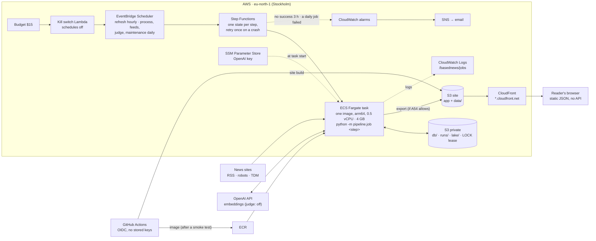
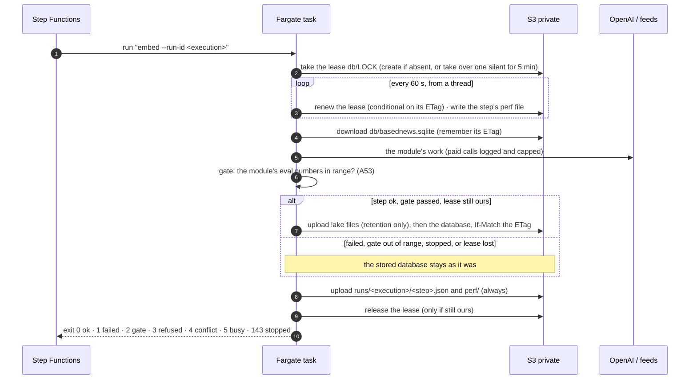
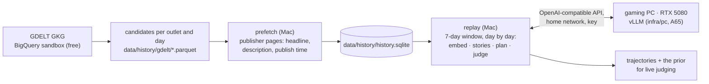

# Architecture — how BasedNews runs in production

The pipeline (README) says *what* is computed. This page says *where* it runs, how the parts talk, where data lives,
what happens when something breaks — and which engineering problems the design had to solve. Decisions and costs:
[ADR-010](decisions/ADR-010-deployment.md), [ADR-012](decisions/ADR-012-self-healing.md); deploying:
[DEPLOY.md](DEPLOY.md); code: [`infra/`](../infra), [`pipeline/job/`](../pipeline/job).

**Status (2026-10-17):** live on AWS since 2026-10-13. Collecting hourly and processing daily, 41 countries; the paid
judge and the deleting maintenance job are built but switched off (both need the maintainer's go). The history is
built locally (not on AWS): see [The history, locally](#the-history-locally).

## The picture

There is no server between readers and data: the site is static files, the positions are JSON written by a job
(ADR-010). Nothing runs between jobs; a task exists only while a step runs.

## The jobs

| Job | Steps | Schedule (UTC) | State | What it changes |
|---|---|---|---|---|
| refresh | ingest | hourly at :05 | on | new articles and headline versions (feeds keep only their latest items) |
| process | normalize → embed → stories | daily 02:35 | on | merged copies, cleaned text, vectors, the 7-day story groups (A63) |
| feeds | sources | daily 03:30 | on | feed health and text policy per outlet |
| judge | measure → export | daily 04:35 | **off** (paid) | new verdicts on new story pairs (A58), positions, `data/plane-latest.json` |
| maintenance | retention `--apply` | daily 05:35 | **off** (deletes) | monthly Parquet files in the lake; old text and vectors deleted (A52) |

Processing is daily rather than hourly because only the daily judge reads stories, and at 41 countries an hourly
re-processing of the window would cost more than the whole budget (see problem 5 below).

## One step, from start to finish

## Where data lives, and for how long

| Data | Where | Kept | Why |
|---|---|---|---|
| Hot database (articles, vectors, stories, verdicts, positions) | `s3://…private/prod/db/` | current + ≈ 1 day of versions | the working set; versions are the backup (A55) |
| Article text and summaries | inside the hot database | 30 days once maintenance is on (`pruned_at`) | only read inside the story window; publishers' text held briefly (A10, A52) |
| Vectors and the headline-vector cache | inside the hot database | 30 days | re-bought if ever needed (A56) |
| Verdicts, positions, spend, job records, article metadata | hot database **and** monthly Parquet in `lake/` | forever | small; refits and the trend model need them (A22, A52) |
| Full judge requests (A51) | hot database, then `lake/judge_call_log/` | blob leaves the database after the month closes and its file is verified | later analyses never re-buy a call |
| Step records and performance files | `s3://…private/prod/runs/<execution>/` | 400 days | what ran, on which commit, what the gate measured, the error; time, CPU, peak memory, cost (A64) |
| Container logs | CloudWatch `/basednews/jobs` | 30 days | line-by-line JSON |
| Public site and positions | `s3://…site/` behind CloudFront | current | aggregates only, never article text (A10) |

## When something breaks

Self-healing lives in the jobs, not in deploys (ADR-012). An email means it did **not** heal.

| What fails | What happens, without anyone | Where to look |
|---|---|---|
| A step crashes, runs out of memory or is killed | its lease stops being renewed; the state machine retries the step after 2 min; the retry takes the lease over after 5 min; the stored database is unchanged | `runs/<execution>/<step>.json`, `lock_taken_over` |
| A task is stopped (StopTask, a timeout) | SIGTERM → record written, nothing uploaded, lease released, within the 120 s stop timeout | `step_stopped` |
| A task hangs | it stops renewing after 80 min and is stopped at 90; the next job takes over | the step record |
| A gate is out of range (e.g. no new articles in 6 h) | exit 2: bad data never reaches the next step or the site | the record's `gate.metrics` and `reason` |
| Two jobs meet | the second waits for the lease up to 45 min, then exits 5; the next schedule tries again | `lock_wait`, `lock_busy` |
| Something else wrote the database meanwhile | the upload is refused (exit 4); nothing is overwritten | `state_conflict` |
| A broken image | CI runs the image's own smoke test (`selftest`) before it becomes `prod`; one that gets through fails runs until fixed, and the alarm says so | the CI run, `commit_sha` in the record |
| No successful refresh for 3 hours / a daily job failed after its retry | **one email**, and an all-clear when it recovers | [DEPLOY.md](DEPLOY.md) "When an alarm email comes" |
| The month's AI spend reaches the cap ($12) | paid calls are refused in code (A48); OpenAI's reload limit is a second cap | `api_usage`, the step record |
| The month's AWS cost passes $15 | the kill switch turns every schedule off and emails; nothing is deleted | the budget email; `terraform apply` re-enables |

## How fast, how big, how much (A64)

Every step attempt writes a performance file — phases (lease wait, download, run, upload), CPU time, peak memory
against the task's limit and the cost at Fargate's price — every minute while it runs, so a step killed for memory
still leaves its numbers. Report:

    cd ~/dev/BasedNews && BASEDNEWS_STATE=s3://<private bucket>/prod AWS_PROFILE=basednews uv run python -m pipeline.job perf --days 1

## Who can do what

| Identity | Can | Cannot |
|---|---|---|
| Job task role | read/write the private bucket; write the site's `data/` | anything else |
| Task execution role | pull the image, write logs, read the one OpenAI parameter | — |
| Step Functions role | start tasks of the job definition, invalidate the CDN cache | — |
| GitHub `deploy` role (main only) | push to the one ECR repo, upload the site, invalidate the cache | delete or overwrite `data/`; change infrastructure (A57) |
| GitHub `plan` role (pull requests) | read-only `terraform plan` | read the private bucket's objects or the secrets |
| The maintainer (SSO admin) | `terraform apply`, secrets typed in the console | — |

## The engineering problems, and how they were solved

The constraints: about $10 a month in total, no always-on server, one person who must not have to babysit it, and a
dataset that grew fivefold in the first week (10 → 41 countries).

**1 · A database for $0 a month.** A managed database costs more than the whole budget. The working set is one
SQLite file in S3; each step downloads it, works, and uploads it only if everything passed, conditional on the version
it downloaded (A55). Correctness rests on two guards: a single-writer lease and S3's conditional writes.

**2 · A lock that heals itself.** The first lock was "create `db/LOCK` if absent". In the first 36 hours a person had
to delete it three times: an ingest crashed (lxml under threads), a stories step ran out of memory, and a stopped
container lived 80 s longer than its execution and re-took the lock. The lock became a **lease** (ADR-012): renewed
every 60 s from a thread, taken over when silent for 5 min, released only by its owner, checked before every upload
(fencing). A clean stop on SIGTERM, one automatic retry per step and alarms on *lack of success* (not on single
failures) complete it. Since then every crash has healed without a person.

**3 · Memory that does not grow with the window.** Story grouping is average-linkage clustering, which needs the
distance of every pair inside a linked group. At 41 countries the 7-day window heads for ≈ 170 k articles with one
linked group of ≈ 85 k: ≈ 60 GB as a pairwise array. Two patches (splitting into connected groups, 2 → 4 GB) bought a
day each. The fix that holds keeps only the close pairs plus running sums of distances between candidate stories
(Lance–Williams), which is exact: identical partitions to the previous method on 41,677 and 60,778 real articles,
1.2 GB instead of 4.9 GB, ≈ 1.6 GB projected for a full window (ADR-004). The same audit made every other step bounded:
normalize works one outlet at a time over 14 days, embed reads its window in chunks, ingest looks up only the URLs in
the current feeds (A63) — each checked identical to the old version on production data.
Lesson recorded: size a fix for the steady state, not for today's data.

**4 · Inputs nobody planned for.** A Greek article exceeded the embedding model's 8,192-token limit (the old character
cap assumed English: Greek is ≈ 5× more tokens per character). Inputs are now cut by the API's own tokenizer, and a
rejected input is isolated by splitting its batch, so one bad text skips one article instead of failing the step.

**5 · Cost at full volume.** Measured on the first days, re-processing the 14-day window every hour would cost
≈ $16 a month at full volume — over budget. Collecting stays hourly (feeds forget), processing moved to once a day
before the judge (A63). The performance report (A64) now measures this for every step instead of estimating it.

**6 · Deploys that cannot break production silently.** CI runs lint, tests, Terraform checks (checkov without the
local variables, as CI sees them) and a smoke test *inside the built image* before tagging it `prod`. CI holds no
keys (OIDC) and cannot change infrastructure (A57). An automatic rollback was built and removed by decision:
self-healing belongs in the jobs.

| When | What broke | Healed by itself? | Fix |
|---|---|---|---|
| 10-14 16:06 | ingest: lxml double free under 6 threads (exit 133) | no (stale lock) | one parser at a time; then the lease |
| 10-15 04:09 | stories: out of memory, old clustering (exit 137) | no (stale lock) | split by linked groups; then the lease |
| 10-15 05:11 | a stopped execution's container re-took the lock | no | the lease (ADR-012) |
| 10-15 | embed: a Greek article over the token limit, every hour | no | tokenizer-exact truncation, isolate rejected inputs |
| 10-15 19:05 | stories: out of memory at 2 GB (a 17.8 k linked group) | retried, failed | 4 GB |
| 10-16 07:05–17:05 | stories: out of memory at 4 GB (a 30 k linked group) | retried, failed; alarm | exact sparse average linkage (problem 3) |
| 10-16 18:05 | stories: out of memory, still on the old image | **yes**: the retry took the lease over and ran the fixed image | — |
| since | no failed run | | |

## The history, locally

The 2015-11 → 2026 history (A61) is built on the maintainer's own hardware, not on AWS, because judging eleven years
of story pairs with a paid model would cost far more than the budget:

- **Sources:** GDELT lists the URLs; each publisher's own page gives the headline and description (A10: never the full
  text, one request at a time per site, robots.txt respected).
- **Local models:** the judge runs on the gaming PC behind an OpenAI-compatible server (`docs/LOCAL_LLM.md`). Whether
  the local embedding model and judge measure like live is tested before any history is judged: E8 (embeddings) and E9
  (judge), both pre-registered.

## Locally, the same thing

`docker compose run --rm job <step>` runs the production image against a folder that behaves like the bucket
(`data/state`, same lease and conditional upload). `uv run python -m pipeline.job <step>` runs it straight on
`data/basednews.sqlite`, with the same records, gates and performance files.
