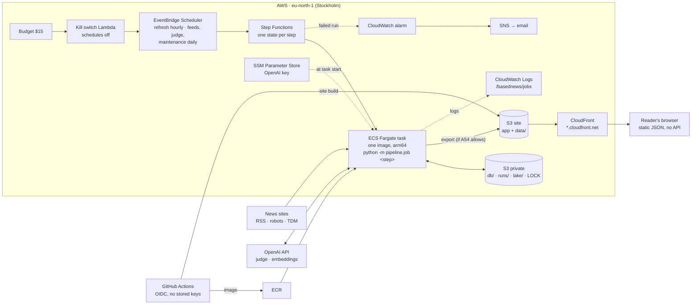
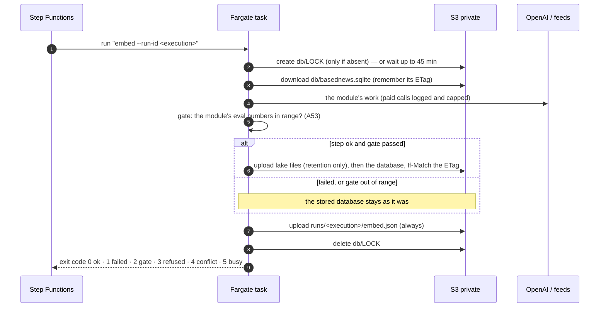

# Architecture — how BasedNews runs in production

The pipeline (README) says *what* is computed. This page says *where* it runs, how the parts talk, where data lives and
what happens when something breaks. Decisions and costs: [ADR-010](decisions/ADR-010-deployment.md); first deploy:
[DEPLOY.md](DEPLOY.md); code: [`infra/`](../infra), [`pipeline/job/`](../pipeline/job).

**Status:** built and checked (Terraform plan, AWS validator, tests); not deployed yet.

## The picture

There is no server between readers and data: the site is static files, the positions are JSON written by a job
(ADR-010). Nothing runs between jobs; a task exists only while a step runs.

## The jobs

| Job | Steps | Schedule (UTC) | What it changes |
|---|---|---|---|
| refresh | ingest → normalize → embed → stories | hourly at :05 | new articles, headline versions, vectors, today's story groups |
| feeds | sources | daily 03:30 | feed health and text policy per outlet |
| judge | measure → export → cache refresh | daily 04:35 | new verdicts on new story pairs (A58), positions, `data/plane-latest.json` |
| maintenance | retention `--apply` | daily 05:35 | monthly Parquet files in the lake; old text and vectors deleted (A52) |

All schedules are created **off** and switched on deliberately; the judge costs money and needs its own go.

## One step, from start to finish

## Where data lives, and for how long

| Data | Where | Kept | Why |
|---|---|---|---|
| Hot database (articles, vectors, stories, verdicts, positions) | `s3://…private/prod/db/` | current + ≈ 1 day of versions | the working set; versions are the backup (A55) |
| Article text and summaries | inside the hot database | 30 days, then deleted (`pruned_at`) | only read inside the story window; publishers' text held briefly (A10, A52) |
| Vectors and the headline-vector cache | inside the hot database | 30 days | re-bought if ever needed (A56) |
| Verdicts, positions, spend, job records, article metadata | hot database **and** monthly Parquet in `lake/` | forever | small; refits and the trend model need them (A22, A52) |
| Full judge requests (A51) | hot database, then `lake/judge_call_log/` | blob leaves the database after the month closes and its file is verified | later analyses never re-buy a call |
| Step records | `s3://…private/prod/runs/<execution>/<step>.json` | 400 days | what ran, on which commit, what the gate measured, the error |
| Container logs | CloudWatch `/basednews/jobs` | 30 days | line-by-line JSON |
| Public site and positions | `s3://…site/` behind CloudFront | current | aggregates only, never article text (A10) |

## When something breaks

| What fails | What happens | Where to look |
|---|---|---|
| A module crashes | exit 1; the stored database is untouched; the next steps of that run are skipped; alarm email | `runs/<execution>/<step>.json` (error + traceback), CloudWatch |
| A gate is out of range (e.g. no new articles in 6 h) | exit 2; same as above: bad data never reaches the next step or the site | the record's `gate.metrics` and `reason` |
| Two jobs meet | the second waits for the lock; after 45 min it exits 5 and the next schedule tries again | `lock_wait` / `lock_busy` log lines |
| Something else wrote the database meanwhile | the upload is refused (exit 4); nothing is overwritten | `state_conflict` log line |
| OpenAI is down or rate-limited | retries with back-off, then the step fails its gate; the site keeps its last good data | the step record |
| The month's AI spend reaches the cap ($12) | paid calls are refused in code (A48); OpenAI's reload limit is a second cap | `api_usage`, the step record |
| The month's AWS cost passes $15 | the kill switch turns every schedule off and emails; nothing is deleted | the budget email; `terraform apply` re-enables |
| A bad image is deployed | the next push replaces it; every record names the commit it ran | `commit_sha` in the record |

## Who can do what

| Identity | Can | Cannot |
|---|---|---|
| Job task role | read/write the private bucket; write the site's `data/` | anything else |
| Task execution role | pull the image, write logs, read the one OpenAI parameter | — |
| Step Functions role | start tasks of the job definition, invalidate the CDN cache | — |
| GitHub `deploy` role (main only) | push to the one ECR repo, upload the site, invalidate the cache | delete or overwrite `data/`; change infrastructure (A57) |
| GitHub `plan` role (pull requests) | read-only `terraform plan` | read the private bucket's objects or the secrets |
| The maintainer (SSO admin) | `terraform apply`, secrets typed in the console | — |

## Locally, the same thing

`docker compose run --rm job <step>` runs the production image against a folder that behaves like the bucket
(`data/state`, same lock and conditional upload). `uv run python -m pipeline.job <step>` runs it straight on
`data/basednews.sqlite`, with the same records and gates.
