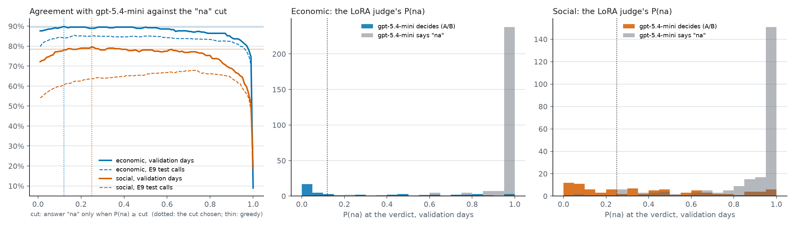

# E12 — the LoRA judge read from its probabilities, with a cut for "na"

Cuts tuned on E11's 324 validation pairs (2026-10-18T16:12:15Z), before any test call: **econ 0.12, social 0.25** — "na" only when P(na) ≥ the cut. E9's 943 test calls asked once with them (C4-T). Not a claim (pipeline phase).

Check of the reading: the likeliest option from the probabilities equals C4's greedy answer on 96.5% (econ) and 93.8% (social) of the test calls.

| | set | agreement | κ | decides | flip (of both decided) | miss | invent |
|---|---|---|---|---|---|---|---|
| greedy econ | validation | 89.5% | 0.55 | 11% | 2.8% (31%) | 6% | 2% |
| greedy social | validation | 78.4% | 0.46 | 21% | 3.7% (24%) | 13% | 5% |
| cut econ | validation | 89.8% | 0.51 | 8% | 2.5% (33%) | 7% | 0% |
| cut social | validation | 79.6% | 0.43 | 14% | 2.2% (18%) | 16% | 2% |
| greedy econ | E9 test | 84.4% | 0.58 | 21% | 6.9% (39%) | 5% | 3% |
| greedy social | E9 test | 64.5% | 0.35 | 24% | 6.6% (30%) | 26% | 3% |
| cut econ | E9 test | 84.1% | 0.49 | 12% | 3.9% (34%) | 12% | 0% |
| cut social | E9 test | 63.6% | 0.31 | 18% | 4.8% (28%) | 31% | 1% |

The dashed test curves are reported, never used to choose. E9's own analysis (reports/e9.md) has C4-T with intervals and the positions check (J3).
