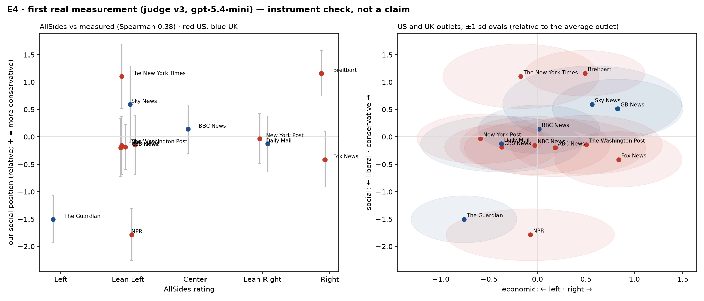

# E4 — first real measurement: instrument check

Pre-registration `docs/experiments/e4_prereg.json` (sha256 `5670842c8f966779…`), written before any measurement call. Judge prompt v3, gpt-5.4-mini. Measurement calls since 2026-10-11T14:05:57Z: **1,433**, **$1.98**, 883 decisive verdicts ($0.0022 per decisive verdict). Validates the instrument; not a claim (pipeline phase).

## Pre-registered checks

| check | result | target | pass |
|---|---|---|---|
| AllSides vs our social position (primary) | Spearman 0.38 on 13 outlets (permutation p = 0.096); econ 0.28, mean of both 0.37 | ≥ 0.60 | ❌ |
| Pre-written contrasts | 7 of 9 decided confirmed (11 undecided or no data); sign test p = 0.090 | ≥ 80 % of decided | ❌ |
| Split halves (US/UK social) | Spearman 0.51 between two random halves (338 calls, 14 outlets) | ≥ 0.70 | ❌ |
| gpt-5.4-nano vs mini | agrees with mini 0.82 / 0.70 (econ / social) vs mini's own retest 0.78 / 0.80; 40 pairs, $0.018 | ≥ retest − 0.10 | ✅ |

## Contrasts

| country | axis | expected: more + than | P(first further +) | outcome |
|---|---|---|---|---|
| US | social | Breitbart > The New York Times | 0.53 | undecided |
| US | social | Fox News > NPR | 0.98 | confirmed |
| US | social | New York Post > The Washington Post | 0.57 | undecided |
| UK | social | GB News > The Guardian | 1.00 | confirmed |
| UK | social | Daily Mail > The Guardian | 0.99 | confirmed |
| UK | social | The Telegraph > The Guardian | 0.92 | confirmed |
| DE | social | Bild > taz | 0.67 | undecided |
| DE | social | Die Welt > taz | 0.33 | undecided |
| DE | social | Frankfurter Allgemeine > Süddeutsche Zeitung | 0.05 | contradicted |
| FR | social | Le Figaro > Libération | 0.87 | confirmed |
| FR | social | Le Figaro > Le Monde | 0.94 | confirmed |
| ES | social | OKDiario > elDiario.es | 0.53 | undecided |
| ES | social | ABC > El País | 0.40 | undecided |
| ES | social | El Mundo > El País | 0.18 | contradicted |
| IT | social | Libero Quotidiano > la Repubblica | 0.95 | confirmed |
| IT | social | Libero Quotidiano > La Stampa | 0.49 | undecided |
| SE | econ | Svenska Dagbladet > Aftonbladet | 0.31 | undecided |
| NO | econ | Aftenposten > Dagbladet | 0.50 | undecided |
| DK | econ | Berlingske > Politiken | 0.47 | undecided |
| DK | social | Jyllands-Posten > Politiken | 0.69 | undecided |

## AllSides vs our position

| outlet | AllSides | social (ours) | econ (ours) | comparisons |
|---|---:|---:|---:|---:|
| NPR | -1 | -1.78 | -0.07 | 39 |
| The Guardian | -2 | -1.50 | -0.76 | 85 |
| Fox News | +2 | -0.41 | +0.84 | 30 |
| ABC News | -1 | -0.20 | +0.18 | 55 |
| CBS News | -1 | -0.19 | -0.37 | 72 |
| NBC News | -1 | -0.16 | -0.03 | 37 |
| The Washington Post | -1 | -0.14 | +0.50 | 44 |
| Daily Mail | +1 | -0.13 | -0.38 | 73 |
| New York Post | +1 | -0.03 | -0.59 | 44 |
| BBC News | +0 | +0.14 | +0.02 | 66 |
| Sky News | -1 | +0.59 | +0.56 | 41 |
| The New York Times | -1 | +1.10 | -0.17 | 46 |
| Breitbart | +2 | +1.16 | +0.49 | 66 |

## Also measured

- 'na' (no angle): econ 90%, social 48%
- judge order bias β: econ -0.95, social -0.86 (randomised order lets the model remove it)
- outlets measured: 71; comparisons per outlet median 39; outlet sd median econ 0.83, social 0.50 (prior sd 1)

