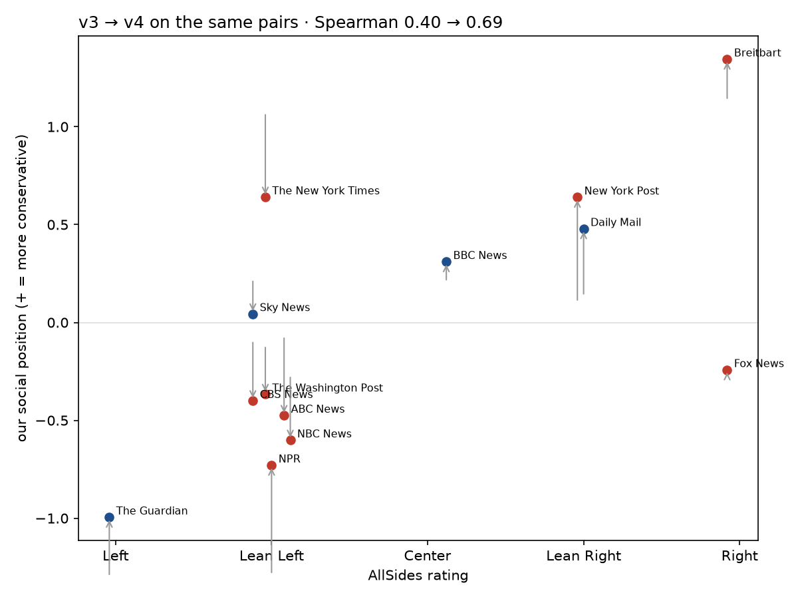

# E4b — same 338 US/UK pairs, prompt v3 vs v4

Only the prompt changed (same pairs, order and question direction). v4 calls: 338, $0.55. Judge: openai.

| | v3 | v4 |
|---|---|---|
| AllSides vs social (Spearman, 13 outlets) | 0.40 | 0.69 |
| US/UK contrasts confirmed (P > 0.8) | 3/5 | 4/5 |
| 'na' econ / social | 82% / 35% | 75% / 39% |
| picks the first-shown (decisive) | 0.44 | 0.48 |
| same verdict as v3 on the same call | – | econ 87% / social 76% |

| outlet (AllSides) | social v3 | social v4 | econ v3 | econ v4 |
|---|---:|---:|---:|---:|
| The Guardian (-2) | -1.30 | -1.00 | -0.89 | -0.56 |
| NPR (-1) | -1.29 | -0.73 | -0.10 | -0.60 |
| NBC News (-1) | -0.27 | -0.60 | -0.08 | +0.17 |
| ABC News (-1) | -0.07 | -0.47 | +0.19 | -0.37 |
| CBS News (-1) | -0.09 | -0.40 | -0.42 | -0.98 |
| The Washington Post (-1) | -0.11 | -0.37 | +0.46 | -0.01 |
| Fox News (+2) ← | -0.28 | -0.24 | +0.76 | +0.63 |
| Sky News (-1) ← | +0.22 | +0.04 | +0.27 | +0.31 |
| BBC News (+0) ← | +0.20 | +0.31 | -0.06 | +0.42 |
| Daily Mail (+1) | +0.13 | +0.48 | -0.39 | +0.19 |
| New York Post (+1) | +0.10 | +0.64 | -0.73 | -0.89 |
| The New York Times (-1) ← | +1.08 | +0.64 | -0.20 | -0.17 |
| Breitbart (+2) | +1.13 | +1.35 | +0.42 | +0.82 |

