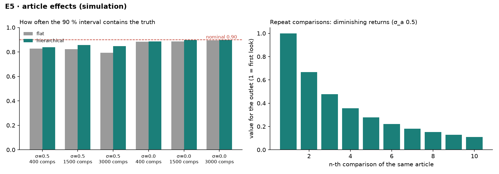

# E5 — one article compared many times: flat vs hierarchical model (simulation)

30 simulated worlds per row, 30 outlets, 160 stories with heavy-tailed size, articles deviate from their outlet by σ_true, judge order bias β = −0.9, comparisons drawn at random from within-story pairs. Nominal coverage is 0.90: an honest model's 90 % intervals contain the truth 90 % of the time.

| σ_true | comparisons | uses per article (mean / max) | model | 90 % coverage | mean sd | mean abs error | Spearman | σ_a chosen |
|---|---:|---|---|---:|---:|---:|---:|---:|
| 0.5 | 400 | 1.9 / 7 | flat | **0.83** | 0.42 | 0.40 | 0.86 | – |
| 0.5 | 400 | 1.9 / 7 | hierarchical | **0.84** | 0.43 | 0.40 | 0.86 | 0.22 |
| 0.5 | 1500 | 4.4 / 16 | flat | **0.82** | 0.23 | 0.23 | 0.95 | – |
| 0.5 | 1500 | 4.4 / 16 | hierarchical | **0.86** | 0.25 | 0.23 | 0.95 | 0.33 |
| 0.5 | 3000 | 5.9 / 18 | flat | **0.79** | 0.20 | 0.21 | 0.95 | – |
| 0.5 | 3000 | 5.9 / 18 | hierarchical | **0.85** | 0.22 | 0.21 | 0.96 | 0.40 |
| 0.0 | 400 | 1.9 / 7 | flat | **0.88** | 0.42 | 0.35 | 0.89 | – |
| 0.0 | 400 | 1.9 / 7 | hierarchical | **0.89** | 0.43 | 0.36 | 0.89 | 0.17 |
| 0.0 | 1500 | 4.4 / 15 | flat | **0.89** | 0.24 | 0.20 | 0.96 | – |
| 0.0 | 1500 | 4.4 / 15 | hierarchical | **0.90** | 0.24 | 0.20 | 0.96 | 0.13 |
| 0.0 | 3000 | 5.9 / 18 | flat | **0.89** | 0.20 | 0.16 | 0.97 | – |
| 0.0 | 3000 | 5.9 / 18 | hierarchical | **0.90** | 0.21 | 0.16 | 0.97 | 0.13 |

Diminishing returns (Gaussian approximation, σ_a = 0.5, one comparison ≈ ±1.0): value for the outlet of the n-th comparison of the same article, relative to the first look at a new article:

| n | 1 | 2 | 3 | 4 | 5 | 6 | 7 | 8 | 9 | 10 |
|---|---:|---:|---:|---:|---:|---:|---:|---:|---:|---:|
| value | 1.00 | 0.67 | 0.48 | 0.36 | 0.28 | 0.22 | 0.18 | 0.15 | 0.13 | 0.11 |

