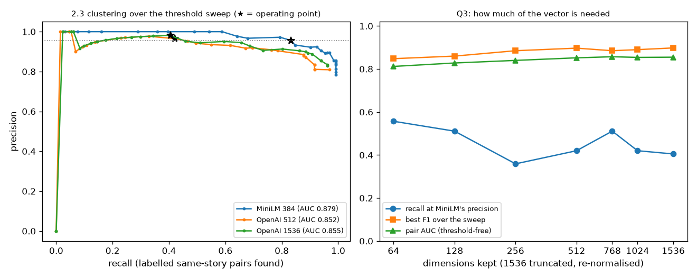

# E7 — OpenAI embeddings 512 vs 1536 vs MiniLM (story matching)

Pre-registration `docs/experiments/e7_prereg.json` (sha256 `acae3a99e72798da…`). 200 labelled pairs (134 same story). Operating point: highest recall with precision ≥ MiniLM's 0.956 (A47). 95 % intervals: 2,000 bootstrap resamples of the pairs, thresholds held fixed.

| model | dims | threshold | precision | recall | F1 | best F1 (thr) | AUC all | AUC band | AUC deployed | MB / 30 days | cost |
|---|---|---|---|---|---|---|---|---|---|---|---|
| MiniLM 384 | 384 | 0.6 | 0.956 [0.913, 0.991] | 0.832 [0.764, 0.894] | 0.89 [0.844, 0.928] | 0.93 (0.46) | 0.879 | 0.922 | 0.789 | 73.7 | $0 |
| OpenAI 512 | 512 | 0.62 | 0.965 [0.909, 1.0] | 0.42 [0.336, 0.508] | 0.585 [0.495, 0.667] | 0.882 (0.3) | 0.852 | 0.912 | 0.684 | 98.3 | $0.0223 |
| OpenAI 1536 | 1536 | 0.6 | 0.981 [0.936, 1.0] | 0.405 [0.321, 0.489] | 0.573 [0.483, 0.653] | 0.898 (0.38) | 0.855 | 0.919 | 0.677 | 294.9 | $0.0223 |

**Q2:** recall 512 − 1536 = 0.015 (95 % [-0.015, 0.044]). Pre-registered rule → **512**.

Recall by label set at the operating point (band = sampled around MiniLM's threshold; deployed = pairs MiniLM clustered together, so MiniLM's recall there is high by construction):

| model | recall band | recall deployed | precision band | precision deployed |
|---|---|---|---|---|
| MiniLM 384 | 0.739 | 0.882 | 0.971 | 0.949 |
| OpenAI 512 | 0.457 | 0.4 | 1.0 | 0.944 |
| OpenAI 1536 | 0.457 | 0.376 | 1.0 | 0.97 |

**Q3:** 1536 truncated and re-normalised:

| dims | threshold | precision | recall | F1 | best F1 | AUC |
|---|---|---|---|---|---|---|
| 64 | 0.56 | 0.961 | 0.557 | 0.705 | 0.848 | 0.812 |
| 128 | 0.58 | 0.957 | 0.511 | 0.667 | 0.86 | 0.828 |
| 256 | 0.64 | 0.959 | 0.359 | 0.522 | 0.885 | 0.84 |
| 512 | 0.62 | 0.965 | 0.42 | 0.585 | 0.897 | 0.852 |
| 768 | 0.58 | 0.957 | 0.511 | 0.667 | 0.885 | 0.857 |
| 1024 | 0.6 | 0.965 | 0.42 | 0.585 | 0.89 | 0.854 |
| 1536 | 0.6 | 0.981 | 0.405 | 0.573 | 0.898 | 0.855 |

**Q4:** API 512-d vs 1536 truncated to 512: mean cosine 0.99999, minimum 0.99696 over 7,093 articles.

